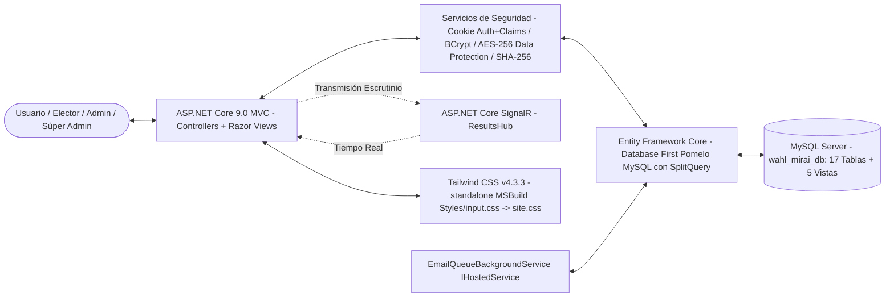
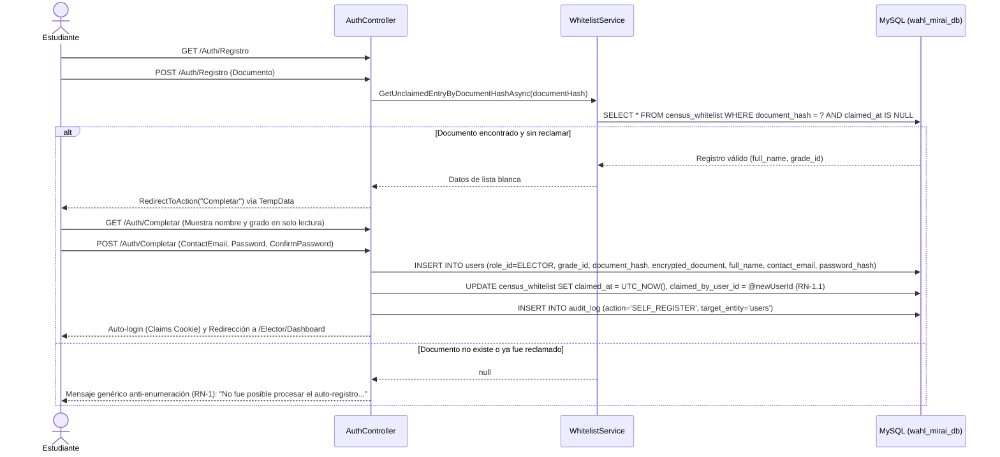
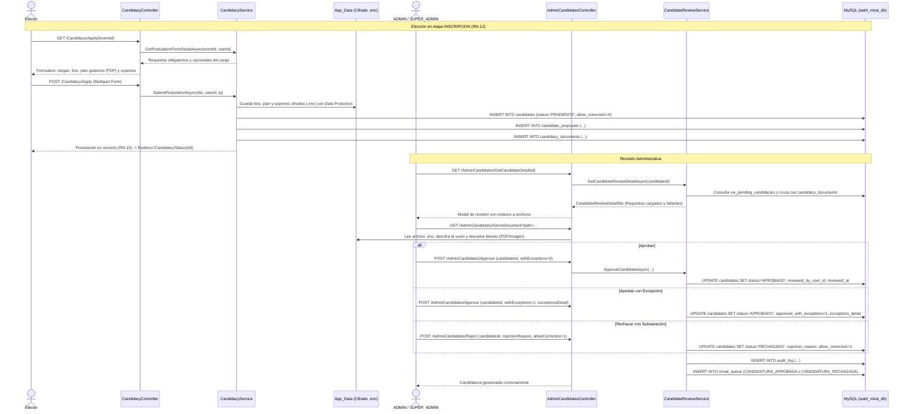
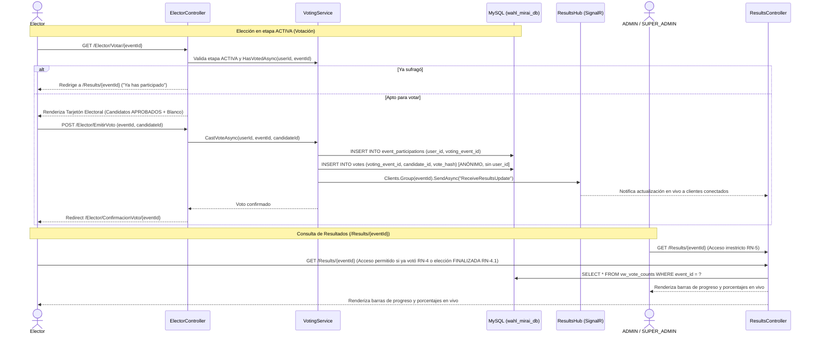

# Arquitectura y Diseño de Software
## Sistema de Votaciones Digitales (Wahl Mirai) — Versión 2.9 (Sincronizada con Implementación Real)

Este documento describe la arquitectura técnica, la estructura real del proyecto en **ASP.NET Core 9.0 MVC** (Razor Views), el modelo de datos relacional (17 tablas físicas y 5 vistas MySQL optimizadas) y los flujos de control del sistema de elecciones **Wahl Mirai**, alineado fielmente con el código fuente y las reglas de negocio de **ERS v2.9**.

> **Nota de sincronización técnica (v2.9):** Esta versión incorpora y formaliza las siguientes capacidades arquitectónicas:
> 1. **Sesión Única Activa y Revocación Inmediata de Acceso en Memoria (RN-14):** Control de sesiones concurrentes e invalidación inmediata de acceso al modificar estado, dar de baja lógica o reasignar contraseñas, operando 100% en RAM mediante `IActiveSessionStore` y `CookieAuthenticationEvents.OnValidatePrincipal`, sin requerir alteraciones al esquema MySQL.
> 2. Mapeo de identidad en Entity Framework Core: la base de datos MySQL implementa las tablas normalizadas `users` y `event_participations`, mientras que el modelo de dominio en C# las mapea mediante las entidades `Voter` y `VoterEventParticipation` utilizando `entity.ToTable("users")` y `entity.ToTable("event_participations")` para mantener la estabilidad del código base.
> 3. Mapeo formal de 5 Vistas MySQL en DbContext: `vw_active_census`, `vw_pending_whitelist`, `vw_pending_email_queue`, `vw_vote_counts` y la recientemente conectada `vw_pending_candidacies` para optimización de consultas complejas.
> 4. Controladores reales con convención administrativa: `AdminCensusController`, `AdminEventsController`, `AdminCandidatesController`, `AdminAccountsController`, `AdminEmailReportController`, `ElectorController` y `RecuperacionAccesoController`.
> 5. Endpoint de descifrado seguro de documentos y fotos: `/AdminCandidates/ServeDocument?path=...` para archivos `.enc` almacenados fuera de `wwwroot`.
> 6. Stack de frontend: compilación MSBuild de Tailwind CSS v4 hacia `site.css`, SignalR en `/hubs/resultsHub`, motor de reglas para Chatbot FAQ, internacionalización en 6 idiomas (`locale.js`) y persistencia de tema claro/oscuro (`theme.js`).

---

## 1. Arquitectura del Sistema

El sistema se desarrolla como una aplicación **ASP.NET Core 9.0 MVC** con **Razor Views** renderizadas en servidor, con capas administrativa y de elector diferenciadas mediante layouts dinámicos (`_AdminLayout` / `_ElectorLayout`). La persistencia y el acceso a datos se gestionan mediante **Entity Framework Core (Database First)** con **Pomelo.EntityFrameworkCore.MySql** sobre **MySQL/XAMPP**:



* **Tecnologías de Frontend:**
  * **Razor Views** semánticas y accesibles, renderizadas en servidor con soporte de localización multi-idioma (`IViewLocalizer`).
  * **Tailwind CSS v4.3.3**, compilado localmente en tiempo de compilación mediante el binario standalone (`tailwindcss.exe` descargado por MSBuild), procesando la hoja `Styles/input.css` hacia `wwwroot/css/site.css` con sistema de tokens semánticos institucional (`--color-primary`, `--color-status-*`) y soporte de modo oscuro con `@custom-variant dark`.
  * **Vanilla JS (ES6+):**
    * `theme.js`: Manejo de tema visual claro/oscuro persistente en `localStorage`.
    * `locale.js`: Motor de traducción en cliente para 6 idiomas (`es`, `en`, `de`, `fr`, `ja`, `zh`).
    * `ayuda-chatbot.js`: Motor conversacional FAQ por reglas cliente con búsqueda por palabras clave, lightbox para infografías y escalamiento a PQR con persistencia en `sessionStorage`.
    * `auth-completar.js`: Medidor en tiempo real de complejidad de contraseñas para auto-registro.
    * `pqr-manage.js`: Gestión asíncrona (AJAX) del panel administrativo de PQR.
  * **ASP.NET Core SignalR:** Cliente JavaScript en la vista de resultados suscrito al canal `/hubs/resultsHub` (`ReceiveResultsUpdate`) para actualización en tiempo real de votos y porcentajes.

* **Tecnologías de Backend:**
  * **C# 13** sobre **.NET 9.0 / ASP.NET Core MVC**.
  * **Cookie Authentication con Claims y Sesión Única Activa (RN-14):** Manejo de sesión mediante cookie firmada (`CookieAuthenticationDefaults.AuthenticationScheme`), con expiración de 2 horas y claims de identidad (`NameIdentifier`, `Name`, `Role`, `Grade`, `SessionStamp`).
  * **Validación e Invalidación en Tiempo Real (`OnValidatePrincipal`):** Interceptor en `Program.cs` que en cada solicitud HTTP:
    1. Verifica en memoria contra `IActiveSessionStore` que el claim `SessionStamp` coincida con el stamp activo del usuario.
    2. Consulta en base de datos (`AsNoTracking`, proyectando solo `Status` y `DeletedAt`) que la cuenta permanezca en estado `ACTIVO` y `deleted_at == null`.
    3. Ante discrepancia de stamp o estado no activo, ejecuta `context.RejectPrincipal()`, `SignOutAsync("Cookies")` y redirige a `/Auth/Login?reason=device` (sesión reemplazada por nuevo dispositivo) o `/Auth/Login?reason=disabled` (cuenta desactivada/eliminada).
    4. `OnRedirectToLogin` preserva el parámetro `?reason=` ante desafíos de autorización (`[Authorize]`).
  * **Decisión de Diseño de Cero Cambios en MySQL:** Todo el control de sesión única y revocación opera en memoria de aplicación (RAM) mediante `IActiveSessionStore` respaldado por `ConcurrentDictionary<uint, SessionEntry>`, siguiendo el patrón desacoplado y de alto rendimiento ya empleado por `PendingPasswordStore`. No se alteró el esquema relacional ni se agregaron columnas a MySQL.
  * **Políticas de Autorización:**
    * Política `"ADMIN"`: Requiere roles `ADMIN` o `SUPER_ADMIN`.
    * Política `"ELECTOR"`: Requiere rol `ELECTOR`.
    * Exclusividad `SUPER_ADMIN`: Aplicada en `AdminAccountsController` mediante `[Authorize(Roles = "SUPER_ADMIN")]`.
  * **Middleware Personalizado:** `UseForcePasswordChange()` intercepta peticiones para obligar el cambio de credenciales temporales en el primer acceso.
  * **Entity Framework Core (Database First):** ORM mediante **Pomelo.EntityFrameworkCore.MySql** (v9.0.0). Configuración global de `QuerySplittingBehavior.SplitQuery` para evitar advertencias de consultas divididas en colecciones múltiples (`Include`).

* **Servicios de Seguridad, Sesión y Cifrado:**
  * **Almacén de Sesión Única (`IActiveSessionStore` / `ActiveSessionStore`):** Servicio Singleton respaldado por un diccionario concurrente en memoria (`ConcurrentDictionary<uint, SessionEntry>`). Administra los estados mediante el enum `SessionInvalidationReason` (`ReplacedByNewDevice`, `AccountDisabledOrDeleted`, `LoggedOut`). Permite registrar stamps, validar vigencia y forzar invalidaciones inmediatas en microsegundos sin sobrecargar el motor de base de datos.
  * **Hashing de contraseñas:** **BCrypt** (factor de trabajo 11); se aplica en el auto-registro del estudiante (RF-M01-00), recuperación de acceso (RF-M01-02) y reasignación administrativa (RF-M07-02, RF-M09-01).
  * **Hash determinístico de documento (`document_hash`):** **SHA-256**, `CHAR(64)`, indexado de manera única para validaciones anti-duplicado y login sin exponer el documento plano.
  * **Cifrado reversible de documento (`encrypted_document`):** **AES-256** vía ASP.NET Core Data Protection API (`IDocumentEncryptionService`), persistido en la carpeta `keys/`. Auto-migración idempotente al arranque de la aplicación para cifrar documentos semilla en texto plano.
  * **Cifrado de Archivos de Candidatura:** Fotos, planes de gobierno y soportes documentales se almacenan cifrados (`.enc`) en `App_Data/candidacy-uploads/candidacies/` fuera de `wwwroot`. Se sirven exclusivamente a administradores autorizados mediante el endpoint seguro `GET /AdminCandidates/ServeDocument?path=...`.

---

## 2. Estructura de Directorios del Proyecto

```
WahlMirai.Web/
│
├── Controllers/
│   ├── AdminAccountsController.cs    # Gestión de cuentas ADMIN/SUPER_ADMIN (M09, exclusivo Súper Admin)
│   ├── AdminCandidatesController.cs  # Revisión de candidaturas (aprobar, rechazar, retirar) y ServeDocument (M04)
│   ├── AdminCensusController.cs      # Carga/gestión de Lista Blanca, censo activo, CSV y promoción anual (M02)
│   ├── AdminEmailReportController.cs # Monitoreo de cola y reporte de entrega de correos electrónicos (RN-9)
│   ├── AdminEventsController.cs      # CRUD de Elecciones, etapas y requisitos de cargos (M03)
│   ├── AuthController.cs             # Login, Logout, Auto-registro en 2 pasos (Registro/Completar) y CambiarClave (M01)
│   ├── CandidacyController.cs        # Autopostulación de electores (Apply), estado (Status) y dashboard (Index) (M04)
│   ├── ElectorController.cs          # Dashboard de elector, emisión de voto (Votar/EmitirVoto) y propuestas (M05)
│   ├── ErrorController.cs            # Páginas de error HTTP amigables (404, 500, etc.)
│   ├── HomeController.cs             # Portada del sistema y redirecciones según rol autenticado
│   ├── PqrController.cs              # Centro de ayuda (/Ayuda, /Pqr público), creación de PQR y gestión admin (M08)
│   ├── ProfileController.cs          # Autogestión de correo y cambio de clave en 2 pasos (M07)
│   ├── RecuperacionAccesoController.cs # Recuperación anónima de contraseña con anti-enumeración (M01)
│   └── ResultsController.cs          # Escrutinio en vivo, reglas de acceso RN-4/4.1/5 y SignalR (M06)
│
├── Models/
│   ├── WahlMiraiDbContext.cs         # DbContext principal (17 tablas físicas + 5 vistas MySQL)
│   │
│   ├── AcademicYear.cs               # Entidad academic_years (año lectivo y promoción)
│   ├── AuditLog.cs                   # Entidad audit_log (auditoría de operaciones sensibles)
│   ├── CandidacyDocument.cs          # Entidad candidacy_documents (soportes documentales de candidatos)
│   ├── Candidate.cs                  # Entidad candidates (postulaciones, voto en blanco y allow_correction)
│   ├── CandidateProposal.cs          # Entidad candidate_proposals (propuestas de campaña)
│   ├── CensusWhitelist.cs            # Entidad census_whitelist (lista blanca de auto-registro M02/M01)
│   ├── ElectionPosition.cs           # Entidad election_positions (catálogo reutilizable de cargos)
│   ├── EmailQueue.cs                 # Entidad email_queue (cola de correos pendientes/enviados/fallidos)
│   ├── EmailSettings.cs              # Configuración SMTP y límites de tasa
│   ├── EventGrade.cs                 # Entidad event_grades (grados habilitados para cada proceso)
│   ├── Grade.cs                      # Entidad grades (grados escolares en orden secuencial)
│   ├── PositionRequirement.cs        # Entidad position_requirements (requisitos obligatorios/opcionales)
│   ├── PqrTicket.cs                  # Entidad pqr_tickets (tickets PQR radicados y respuestas admin)
│   ├── Role.cs                       # Entidad roles (ELECTOR, ADMIN, SUPER_ADMIN)
│   ├── Roles.cs                      # Constantes de roles para autorización
│   ├── Vote.cs                       # Entidad votes (votos cifrados anónimos con vote_hash)
│   ├── Voter.cs                      # Entidad mapeada a tabla MySQL 'users' (electores y cuentas admin)
│   ├── VoterEventParticipation.cs    # Entidad mapeada a tabla MySQL 'event_participations' (control anti-doble voto)
│   ├── VotingEvent.cs                # Entidad voting_events (procesos electorales y ventanas de etapa)
│   │
│   ├── VwActiveCensu.cs              # Vista MySQL vw_active_census (censo con grado legible)
│   ├── VwPendingCandidacy.cs         # Vista MySQL vw_pending_candidacies (candidaturas pendientes con requisitos)
│   ├── VwPendingEmailQueue.cs        # Vista MySQL vw_pending_email_queue (cola de correo para background worker)
│   ├── VwPendingWhitelist.cs         # Vista MySQL vw_pending_whitelist (entradas no reclamadas de lista blanca)
│   └── VwVoteCount.cs                # Vista MySQL vw_vote_counts (conteo y porcentaje en tiempo real)
│
├── ViewModels/
│   ├── AdminAccountViewModels.cs     # ViewModels para alta y edición de cuentas administrativas (M09)
│   ├── AuthViewModels.cs             # LoginViewModel y ChangePasswordViewModel
│   ├── ErrorViewModel.cs             # Representación de errores en vistas de fallo
│   ├── PagedResult.cs                # Estructura genérica para paginación de listados
│   ├── PqrDtos.cs                    # PqrCreateDto y PqrResponseDto
│   ├── ProfileViewModel.cs           # Perfil de usuario y actualización de contacto (M07)
│   ├── RecuperarAccesoViewModel.cs   # Formulario de solicitud de nueva contraseña
│   └── RegistroViewModels.cs         # RegistroStep1ViewModel (documento) y RegistroStep2ViewModel (datos)
│
├── Services/
│   ├── IActiveSessionStore.cs / ActiveSessionStore.cs # Almacén singleton en memoria de sesión activa y motivos de revocación (RN-14)
│   ├── IAuditService.cs / AuditService.cs             # Registro centralizado de auditoría en audit_log (RN-8)
│   ├── IAuthService.cs (AuthService)                  # Autenticación, hashing SHA-256/BCrypt y cookie claims
│   ├── ICensusService.cs (CensusService)              # Censo paginado, edición, borrado lógico, lista blanca e invalidación de sesión
│   ├── IVotingService.cs (VotingService)              # Consulta de procesos, emisión de voto y SignalR trigger
│   ├── IPromotionService.cs (PromotionService)        # Algoritmo de promoción anual de grado y egreso
│   ├── IEventService.cs (EventService)                # CRUD de eventos, ventanas de tiempo y cálculo de etapas
│   ├── IProfileService.cs (ProfileService)            # Actualización de datos de perfil y verificación de clave
│   ├── ICandidateReviewService.cs (CandidateReviewService) # Aprobación/Rechazo de candidaturas usando vw_pending_candidacies
│   ├── ICandidacyService.cs (CandidacyService)        # Registro de postulación, plan y carga cifrada de soportes
│   ├── IAdminAccountService.cs (AdminAccountService)  # Operaciones M09 sobre usuarios administrativos e invalidación de sesión
│   ├── IWhitelistService.cs (WhitelistService)        # Validación y reclamo atómico de lista blanca (RN-1.1)
│   ├── IEmailSender.cs / MailKitEmailSender.cs        # Envío SMTP real mediante MailKit con STARTTLS
│   ├── IPendingPasswordStore.cs (PendingPasswordStore)# Almacén temporal en memoria para despacho seguro de credenciales
│   ├── ICredentialService.cs (CredentialService)      # Generación de claves aleatorias y encolamiento
│   ├── IDocumentEncryptionService.cs (DocumentEncryptionService) # AES-256 Data Protection (Singleton)
│   └── EmailQueueBackgroundService.cs                 # BackgroundService para despacho progresivo (RN-9)
│
├── Hubs/
│   └── ResultsHub.cs                 # Hub SignalR (/hubs/resultsHub) para actualización en vivo de escrutinio
│
├── Middleware/
│   └── ForcePasswordChangeMiddleware.cs # Interceptor que redirige a CambiarClave si la contraseña es temporal
│
├── Styles/
│   └── input.css                     # Entrada de Tailwind CSS v4 con tokens de diseño semánticos y modo oscuro
│
├── Views/
│   ├── AdminAccounts/                # Index.cshtml (gestión Súper Admin)
│   ├── AdminCandidates/              # Index.cshtml (revisión de postulaciones)
│   ├── AdminCensus/                  # Index.cshtml, PendingWhitelist.cshtml (gestión de censo y lista blanca)
│   ├── AdminEmailReport/             # Index.cshtml (panel de monitoreo de correos)
│   ├── AdminEvents/                  # Index.cshtml, Form.cshtml, Edit.cshtml, _ConfigurePersonas.cshtml
│   ├── Auth/                         # Login.cshtml, Registro.cshtml, Completar.cshtml, CambiarClave.cshtml
│   ├── Candidacy/                    # Index.cshtml, Apply.cshtml, Status.cshtml (autopostulación de electores)
│   ├── Elector/                      # Dashboard.cshtml, Votar.cshtml, Propuestas.cshtml, ConfirmacionVoto.cshtml
│   ├── Error/                        # 404.cshtml, 500.cshtml
│   ├── Home/                         # Index.cshtml (portada y bienvenida)
│   ├── Pqr/                          # Index.cshtml (Ayuda + Chatbot), Create.cshtml, Manage.cshtml
│   ├── Profile/                      # Index.cshtml (perfil y modal de 2 pasos)
│   ├── RecuperacionAcceso/           # Recuperar.cshtml, Exito.cshtml
│   ├── Results/                      # Index.cshtml (gráficas de escrutinio en tiempo real con SignalR)
│   └── Shared/                       # _AdminLayout.cshtml, _ElectorLayout.cshtml, _ValidationScriptsPartial.cshtml
│
├── App_Data/
│   └── candidacy-uploads/candidacies/ # Almacén seguro fuera de wwwroot de archivos .enc (fotos, planes, soportes)
│
├── keys/                             # Llaves criptográficas de ASP.NET Core Data Protection
│
└── wwwroot/
    ├── css/
    │   └── site.css                  # Hoja de estilos procesada y minificada por Tailwind CSS v4
    ├── img/
    │   └── ayuda/                    # Ilustraciones SVG oficiales del módulo M08 (RF-M08-00)
    │       ├── ayuda-login.svg
    │       ├── ayuda-perfil.svg
    │       ├── ayuda-postulacion.svg
    │       ├── ayuda-recuperar.svg
    │       ├── ayuda-registro.svg
    │       ├── ayuda-resultados.svg
    │       └── ayuda-votar.svg
    ├── images/                       # Assets estáticos (default-avatar.png, login-background.jpg, etc.)
    └── js/
        ├── auth-completar.js         # Medidor de fuerza de clave y validación interactiva de auto-registro
        ├── ayuda-chatbot.js          # Chatbot conversacional FAQ por reglas cliente con escalamiento a PQR
        ├── locale.js                 # Diccionarios y motor de traducción i18n cliente (6 idiomas)
        ├── pqr-manage.js             # Panel interactivo para resolución y filtrado de PQR
        ├── site.js                   # Scripts generales
        └── theme.js                  # Conmutador y persistencia de tema claro/oscuro
```

---

## 3. Modelo de Datos (17 Tablas Físicas y 5 Vistas MySQL)

El modelo de base de datos relacional opera sobre el esquema `wahl_mirai_db`.

```mermaid
erDiagram
    roles ||--o{ users : "asigna_rol"
    grades ||--o{ users : "pertenece_a_grado"
    grades ||--o{ census_whitelist : "pertenece_a_grado"
    users ||--o{ census_whitelist : "carga_lista_blanca"
    users ||--o? census_whitelist : "reclama_registro"
    grades ||--o{ event_grades : "habilitado_en"
    election_positions ||--o{ position_requirements : "define_requisitos"
    election_positions ||--o{ voting_events : "clasifica_cargo"
    voting_events ||--o{ event_grades : "clasifica_grados"
    users ||--o{ email_queue : "receptores_cola"
    users ||--o{ voting_events : "creado_por"
    voting_events ||--o{ candidates : "recibe_postulaciones"
    users ||--o? candidates : "se_autopostula"
    users ||--o{ candidates : "revisa_candidatura"
    candidates ||--o{ candidate_proposals : "posee_propuestas"
    candidates ||--o{ candidacy_documents : "adjunta_soportes"
    position_requirements ||--o{ candidacy_documents : "exige_soporte"
    voting_events ||--o{ votes : "recibe_votos"
    candidates ||--o{ votes : "acumula_votos"
    users ||--o{ event_participations : "registra_participacion"
    voting_events ||--o{ event_participations : "rastrea_emision"
    users ||--o{ audit_log : "ejecuta_accion"
    users ||--o{ pqr_tickets : "crea_ticket"
    users ||--o? pqr_tickets : "resuelve_ticket"

    roles {
        TINYINT id PK
        VARCHAR_30 name "ELECTOR, ADMIN, SUPER_ADMIN"
        VARCHAR_100 description
    }

    academic_years {
        SMALLINT id PK
        SMALLINT year "UK"
        TINYINT_1 is_current
        DATETIME promotion_executed_at
        DATETIME created_at
    }

    grades {
        TINYINT id PK
        VARCHAR_10 name "UK"
        TINYINT sequence_order "UK"
        TINYINT_1 is_last_grade
    }

    census_whitelist {
        INT id PK
        CHAR_64 document_hash "UK"
        VARCHAR_500 encrypted_document
        VARCHAR_150 full_name
        TINYINT grade_id FK
        TINYINT_1 excluir_de_promocion
        DATETIME claimed_at "NULL = no reclamado"
        INT claimed_by_user_id FK "Nullable"
        INT uploaded_by_user_id FK
        DATETIME created_at
    }

    users {
        INT id PK
        TINYINT role_id FK
        TINYINT grade_id FK "NULL para cuentas administrativas"
        CHAR_64 document_hash "UK"
        VARCHAR_500 encrypted_document
        VARCHAR_150 full_name
        VARCHAR_150 contact_email
        VARCHAR_255 password_hash
        VARCHAR_100 position_title "Solo ADMIN/SUPER_ADMIN"
        TINYINT_1 excluir_de_promocion
        ENUM status "ACTIVO, INACTIVO, ELIMINADO, EGRESADO"
        DATETIME deleted_at
        DATETIME registered_at
        DATETIME updated_at
    }

    email_queue {
        BIGINT id PK
        INT user_id FK
        ENUM email_type "RECUPERACION_ACCESO, REASIGNACION_ADMIN, CAMBIO_PERFIL, RESPUESTA_PQR, CANDIDATURA_APROBADA, CANDIDATURA_RECHAZADA"
        ENUM status "PENDIENTE, ENVIADO, FALLIDO"
        TINYINT attempts
        TEXT error_message
        DATETIME created_at
        DATETIME sent_at
    }

    election_positions {
        INT id PK
        VARCHAR_100 name "Personero, Contralor, etc."
        TEXT description
        ENUM status "ACTIVO, INACTIVO"
        DATETIME created_at
    }

    position_requirements {
        INT id PK
        INT position_id FK
        VARCHAR_255 description
        TINYINT_1 is_mandatory
        TINYINT display_order
    }

    voting_events {
        INT id PK
        INT created_by_user_id FK
        INT position_id FK
        VARCHAR_200 title
        ENUM election_type "PERSONAS, TEMAS"
        DATE registration_start_date
        TIME registration_start_time
        DATE registration_end_date
        TIME registration_end_time
        DATE proposals_start_date
        TIME proposals_start_time
        DATE proposals_end_date
        TIME proposals_end_time
        DATE voting_start_date
        TIME voting_start_time
        DATE voting_end_date
        TIME voting_end_time
        ENUM status "PROGRAMADA, INSCRIPCION, PROPUESTAS, ACTIVA, FINALIZADA, ELIMINADO"
        DATETIME deleted_at
        DATETIME created_at
    }

    event_grades {
        INT id PK
        INT voting_event_id FK
        TINYINT grade_id FK
    }

    candidates {
        INT id PK
        INT voting_event_id FK
        INT user_id FK "Nullable si es voto en blanco"
        VARCHAR_150 name
        TEXT slogan
        VARCHAR_500 photo_url
        VARCHAR_500 government_plan_url
        TINYINT_1 is_blank_vote
        ENUM status "PENDIENTE, APROBADO, RECHAZADO"
        TINYINT_1 approved_with_exceptions
        TEXT exceptions_detail
        TEXT rejection_reason
        TINYINT_1 allow_correction "1 = permite subsanar candidatura"
        INT reviewed_by_user_id FK "Nullable"
        DATETIME reviewed_at
        DATETIME enrolled_at
    }

    candidate_proposals {
        INT id PK
        INT candidate_id FK
        TEXT content
        TINYINT display_order
    }

    candidacy_documents {
        INT id PK
        INT candidate_id FK
        INT requirement_id FK
        VARCHAR_500 file_url
        DATETIME uploaded_at
    }

    votes {
        BIGINT id PK
        INT voting_event_id FK
        INT candidate_id FK
        VARCHAR_64 vote_hash "UK - SHA-256 criptografico"
        DATETIME voted_at
    }

    event_participations {
        INT id PK
        INT user_id FK
        INT voting_event_id FK
        DATETIME participated_at
    }

    audit_log {
        BIGINT id PK
        INT user_id FK "Nullable si fue el sistema"
        VARCHAR_100 action
        VARCHAR_200 target_entity
        INT target_id
        VARCHAR_100 field_name
        TEXT old_value
        TEXT new_value
        TEXT details
        DATETIME occurred_at
    }

    pqr_tickets {
        BIGINT id PK
        INT user_id FK
        VARCHAR_200 subject
        TEXT message
        ENUM status "ABIERTO, RESUELTO"
        TEXT admin_response
        INT responded_by_user_id FK "Nullable"
        DATETIME responded_at
        DATETIME created_at
        DATETIME updated_at
    }
```

### 3.1 Mapeo de Entidades C# vs Tablas MySQL
Para garantizar la estabilidad del software y respetar el código histórico sin introducir cambios de ruptura, Entity Framework Core mapea las entidades de la siguiente manera en [WahlMiraiDbContext.cs](file:///c:/Users/APRENDIZ/Documents/proej/WAHL-MIRAI/WahlMirai.Web/Models/WahlMiraiDbContext.cs):
* `Voter` $\rightarrow$ Tabla física MySQL **`users`** (`entity.ToTable("users")`).
* `VoterEventParticipation` $\rightarrow$ Tabla física MySQL **`event_participations`** (`entity.ToTable("event_participations")`).
* Claves foráneas que referencian a usuarios en la base de datos se denominan `user_id`, `created_by_user_id`, `reviewed_by_user_id`, `responded_by_user_id` y `claimed_by_user_id`.

### 3.2 Vistas MySQL Mapeadas en Entity Framework Core
El sistema implementa 5 vistas SQL keyless (`.HasNoKey()`) registradas en `WahlMiraiDbContext`:

1. **`vw_vote_counts` (`VwVoteCount.cs`):**  
   Precalcula el total de sufragios y el porcentaje sobre el total de la elección en tiempo real. Excluye elecciones eliminadas lógicamente (`status != 'ELIMINADO'`, RN-7.1) y contabiliza únicamente candidatos en estado `APROBADO` o voto en blanco.
2. **`vw_active_census` (`VwActiveCensu.cs`):**  
   Optimiza la consulta paginada del censo activo (electores `ACTIVO` e `INACTIVO`), resolviendo el nombre textual del grado escolar (`grades.name`) mediante un JOIN directo en el motor de base de datos.
3. **`vw_pending_whitelist` (`VwPendingWhitelist.cs`):**  
   Proyecta las entradas cargadas en la lista blanca que aún no han sido reclamadas (`claimed_at IS NULL`), uniendo el grado legible para la gestión administrativa de M02.
4. **`vw_pending_email_queue` (`VwPendingEmailQueue.cs`):**  
   Filtra los correos en estado `PENDIENTE` con los datos del destinatario (`users.contact_email`, `users.full_name`) para que el worker `EmailQueueBackgroundService` los consuma progresivamente sin uniones pesadas.
5. **`vw_pending_candidacies` (`VwPendingCandidacy.cs`):**  
   Proyecta las candidaturas en estado `PENDIENTE` (M04), calculando en dos subconsultas el total de requisitos obligatorios del cargo (`mandatory_requirements`) y los documentos obligatorios ya cargados por el aspirante (`mandatory_documents_uploaded`). Permite al servicio `CandidateReviewService` saber de inmediato si una postulación es elegible para aprobación directa.

---

## 4. Diagramas de Flujo de Procesos Clave

### 4.1 Auto-registro del Elector (RF-M01-00)



### 4.2 Autopostulación y Revisión de Candidatura (RF-M04-01, RF-M04-02)



### 4.3 Proceso de Votación y Escrutinio en Tiempo Real



---

## 5. Matriz de Módulos, Controladores y Reglas de Negocio

### 5.1 M01 — Gestión de Acceso, Auto-registro y Sesión
* **Controladores:** [AuthController.cs](file:///c:/Users/APRENDIZ/Documents/proej/WAHL-MIRAI/WahlMirai.Web/Controllers/AuthController.cs), [RecuperacionAccesoController.cs](file:///c:/Users/APRENDIZ/Documents/proej/WAHL-MIRAI/WahlMirai.Web/Controllers/RecuperacionAccesoController.cs).
* **Servicios:** `IAuthService`, `IWhitelistService`, `ICredentialService`, `IActiveSessionStore`.
* **Endpoints:**
  * `GET/POST /Auth/Login`: Acceso con documento y contraseña; valida estado `ACTIVO`, genera claims, registra sesión única en `IActiveSessionStore` emitiendo el claim `SessionStamp` y establece la cookie. Admite parámetro `?reason=` (`device`, `disabled`) para retroalimentación al usuario.
  * `GET/POST /Auth/Registro` y `GET/POST /Auth/Completar`: Flujo de auto-registro en 2 pasos validando contra `census_whitelist` (RF-M01-00) y marcando la entrada como reclamada (RN-1.1) con protección anti-enumeración (RN-1). Al completar, registra sesión única en `IActiveSessionStore` emitiendo `SessionStamp` y realiza auto-login.
  * `GET/POST /Auth/CambiarClave`: Cambio obligatorio (`UseForcePasswordChange`) o voluntario de credenciales (`[Authorize]`).
  * `GET /Auth/Logout`: Invalida la sesión activa en `IActiveSessionStore` (`SessionInvalidationReason.LoggedOut`) y destruye la cookie de autenticación.
  * `GET/POST /RecuperacionAcceso/Recuperar`: Generación de clave temporal y encolamiento en `email_queue` con respuesta genérica anti-enumeración.

### 5.2 M02 — Censo Electoral y Lista Blanca (Exclusivo Administrador)
* **Controlador:** [AdminCensusController.cs](file:///c:/Users/APRENDIZ/Documents/proej/WAHL-MIRAI/WahlMirai.Web/Controllers/AdminCensusController.cs) (`[Authorize(Roles = "ADMIN,SUPER_ADMIN")]`).
* **Servicios:** `ICensusService`, `IPromotionService`, `IDocumentEncryptionService`, `IActiveSessionStore`.
* **Endpoints:**
  * `GET /AdminCensus/Index`: Censo activo paginado con filtros dinámicos (consume `vw_active_census`).
  * `GET /AdminCensus/GetVoterDetails`: Retorna DTO con documento descifrado para modal administrativo.
  * `POST /AdminCensus/EditVoter`: Edición de datos personales, grado y estado. Si el estado cambia a un valor diferente de `ACTIVO`, revoca inmediatamente la sesión activa en `IActiveSessionStore` (`UpdateVoterAsync`) y asienta `USER_UPDATED` en `users`.
  * `POST /AdminCensus/DeleteVoter`: Eliminación lógica (`status = 'ELIMINADO'`, `deleted_at = NOW()`, RN-6). Revoca inmediatamente la sesión activa en `IActiveSessionStore` (`SoftDeleteVoterAsync`) y asienta `USER_DELETED` en `users`.
  * `POST /AdminCensus/RestoreVoter`: Restauración a estado `ACTIVO`. Asienta `USER_RESTORED` en `users`.
  * `POST /AdminCensus/ResetPassword`: Reasigna contraseña temporal por correo, revoca inmediatamente la sesión activa en `IActiveSessionStore` (`ResetPasswordAsync`) forzando nuevo login y asienta `PASSWORD_REASSIGNED` en `users`.
  * `GET /AdminCensus/PendingWhitelist`: Listado paginado de entradas no reclamadas (consume `vw_pending_whitelist`).
  * `POST /AdminCensus/AddToWhitelist`: Registro individual en lista blanca (documento cifrado + hash).
  * `POST /AdminCensus/CargaCsv`: Importación masiva en transacción atómica con reporte de duplicados y errores de fila.
  * `GET /AdminCensus/DescargarPlantillaCsv`: Descarga oficial de la plantilla CSV.
  * `POST /AdminCensus/PromocionAnual`: Promueve el grado escolar de electores activos y entradas de lista blanca según `sequence_order` (RF-M02-02).

### 5.3 M03 — Gestión de Elecciones, Cargos y Etapas
* **Controlador:** [AdminEventsController.cs](file:///c:/Users/APRENDIZ/Documents/proej/WAHL-MIRAI/WahlMirai.Web/Controllers/AdminEventsController.cs) (`[Authorize(Roles = "ADMIN,SUPER_ADMIN")]`).
* **Servicio:** `IEventService`.
* **Endpoints:**
  * `GET /AdminEvents/Index`: Listado de elecciones activas e históricas (excluye `ELIMINADO`).
  * `GET/POST /AdminEvents/Create`: Configura elección, grados habilitados (`event_grades`), cargo clasificado (`position_id`), las tres ventanas cronológicas de etapa (inscripción, propuestas y votación, RN-12) y guarda los requisitos documentales del cargo.
  * `GET/POST /AdminEvents/Edit/{id}`: Modificación de parámetros y configuración de candidatos.
  * `POST /AdminEvents/Delete/{id}`: Soft-delete del proceso electoral (`status = 'ELIMINADO'`, `deleted_at = NOW()`, RN-7.1).

### 5.4 M04 — Autopostulación y Revisión de Candidaturas
* **Controladores:**
  * [CandidacyController.cs](file:///c:/Users/APRENDIZ/Documents/proej/WAHL-MIRAI/WahlMirai.Web/Controllers/CandidacyController.cs) (`[Authorize(Roles = "ELECTOR")]`): Autopostulación (`Apply`), consulta de estado (`Status`) e historial de candidaturas (`Index`).
  * [AdminCandidatesController.cs](file:///c:/Users/APRENDIZ/Documents/proej/WAHL-MIRAI/WahlMirai.Web/Controllers/AdminCandidatesController.cs) (`[Authorize(Roles = "ADMIN,SUPER_ADMIN")]`): Revisión administrativa.
* **Servicios:** `ICandidacyService`, `ICandidateReviewService`.
* **Endpoints:**
  * `GET/POST /Candidacy/Apply/{id}`: Elector carga propuestas, plan de gobierno y archivos de requisitos durante etapa `INSCRIPCION`.
  * `GET /AdminCandidates/GetCandidateDetail`: Detalle técnico de la postulación usando la vista `vw_pending_candidacies`.
  * `GET /AdminCandidates/ServeDocument?path=...`: Endpoint que descifra y sirve fotos o PDFs de forma segura.
  * `POST /AdminCandidates/Approve`: Aprobación regular o con excepción (`approved_with_exceptions=1`, `exceptions_detail`).
  * `POST /AdminCandidates/Reject`: Rechazo obligatorio con motivo; admite `allowCorrection=true` para subsanación.
  * `POST /AdminCandidates/Withdraw`: Retiro formal de candidatura con justificación obligatoria.

### 5.5 M05 — Proceso de Votación y Control de Voto Único
* **Controlador:** [ElectorController.cs](file:///c:/Users/APRENDIZ/Documents/proej/WAHL-MIRAI/WahlMirai.Web/Controllers/ElectorController.cs) (`[Authorize(Roles = "ELECTOR")]`).
* **Servicio:** `IVotingService`.
* **Endpoints:**
  * `GET /Elector/Dashboard`: Elecciones disponibles según el grado del estudiante.
  * `GET /Elector/Propuestas/{id}`: Consulta de planes de gobierno y propuestas durante etapa `PROPUESTAS`.
  * `GET /Elector/Votar/{id}`: Tarjetón electoral interactivo; solo accesible en etapa `ACTIVA` y si no ha votado.
  * `POST /Elector/EmitirVoto`: Inserta en `event_participations` para control anti-duplicado y registra de forma completamente anónima en `votes` con `vote_hash` SHA-256 (sin FK al usuario).

### 5.6 M06 — Escrutinio y Resultados en Tiempo Real
* **Controlador:** [ResultsController.cs](file:///c:/Users/APRENDIZ/Documents/proej/WAHL-MIRAI/WahlMirai.Web/Controllers/ResultsController.cs) (`[Authorize]`).
* **Hub:** [ResultsHub.cs](file:///c:/Users/APRENDIZ/Documents/proej/WAHL-MIRAI/WahlMirai.Web/Hubs/ResultsHub.cs) (`/hubs/resultsHub`).
* **Endpoints:**
  * `GET /Results/{id}`: Pantalla de resultados; valida reglas RN-4 (elector debe haber votado si está `ACTIVA`), RN-4.1 (abierto a electores habilitados si está `FINALIZADA`) y RN-5 (acceso irrestricto para `ADMIN` y `SUPER_ADMIN`). Consume `vw_vote_counts`.
  * `GET /Results/GetLiveData/{id}`: Endpoint JSON para refresco periódico o fallback de SignalR.

### 5.7 M07 — Perfil de Usuario y Autogestión
* **Controlador:** [ProfileController.cs](file:///c:/Users/APRENDIZ/Documents/proej/WAHL-MIRAI/WahlMirai.Web/Controllers/ProfileController.cs) (`[Authorize]`).
* **Servicio:** `IProfileService`.
* **Endpoints:**
  * `GET /Profile/Index`: Visualización de datos (documento descifrado, correo, rol, cargo).
  * `POST /Profile/VerifyCurrentPassword`: Validación asíncrona de contraseña (Paso 1 del modal).
  * `POST /Profile/UpdateContactEmail`: Actualización de correo de contacto (Paso 2).
  * `POST /Profile/ChangePassword`: Actualización de contraseña (Paso 2).

### 5.8 M08 — Ayuda, Chatbot FAQ y PQR
* **Controlador:** [PqrController.cs](file:///c:/Users/APRENDIZ/Documents/proej/WAHL-MIRAI/WahlMirai.Web/Controllers/PqrController.cs).
* **Scripts:** `ayuda-chatbot.js`, `pqr-manage.js`.
* **Endpoints:**
  * `GET /Ayuda` y `GET /Pqr` (`[AllowAnonymous]`): Centro de ayuda público con 7 infografías SVG y chatbot por reglas sin IA generativa.
  * `GET/POST /Pqr/Create` (`[Authorize(Roles = "ELECTOR")]`): Radicación formal de peticiones, quejas o reclamos.
  * `GET /Pqr/Mine` (`[Authorize(Roles = "ELECTOR")]`): Historial de tickets radicados por el estudiante.
  * `GET /Pqr/Manage` (`[Authorize(Roles = "ADMIN,SUPER_ADMIN")]`): Panel administrativo de visualización de tickets.
  * `POST /Pqr/Respond`: Envío de respuesta institucional y resolución del ticket.

### 5.9 M09 — Cuentas Administrativas (Exclusivo Súper Administrador)
* **Controlador:** [AdminAccountsController.cs](file:///c:/Users/APRENDIZ/Documents/proej/WAHL-MIRAI/WahlMirai.Web/Controllers/AdminAccountsController.cs) (`[Authorize(Roles = "SUPER_ADMIN")]`).
* **Servicios:** `IAdminAccountService`, `IActiveSessionStore`.
* **Endpoints:**
  * `GET /AdminAccounts/Index`: Listado de cuentas con roles `ADMIN` y `SUPER_ADMIN`.
  * `POST /AdminAccounts/Create`: Creación de cuenta, asignación de `position_title` y encolamiento de contraseña inicial.
  * `POST /AdminAccounts/Edit`: Edición de datos y rol de la cuenta administrativa (`UpdateAsync`). Si el estado deja de ser `ACTIVO`, revoca inmediatamente la sesión activa en `IActiveSessionStore`.
  * `POST /AdminAccounts/Delete`: Eliminación lógica (`SoftDeleteAsync`) con bloqueo de auto-eliminación para el Súper Admin en sesión. Revoca de inmediato la sesión activa en `IActiveSessionStore`.

### 5.10 Servicio de Cola de Correo Progresivo (RN-9)
* **Controlador:** [AdminEmailReportController.cs](file:///c:/Users/APRENDIZ/Documents/proej/WAHL-MIRAI/WahlMirai.Web/Controllers/AdminEmailReportController.cs) (`[Authorize(Roles = "ADMIN,SUPER_ADMIN")]`).
* **Worker:** [EmailQueueBackgroundService.cs](file:///c:/Users/APRENDIZ/Documents/proej/WAHL-MIRAI/WahlMirai.Web/Services/EmailQueueBackgroundService.cs) (`IHostedService`).
* **Funcionamiento:** Consulta periódica de `vw_pending_email_queue`, control de tasa mediante `EmailSettings:RateLimitPerMinute`, despacho con reintentos (máximo 3) y registro del estado final (`ENVIADO` o `FALLIDO`) con estampa de tiempo `sent_at` y mensaje de error en `email_queue`.

### 5.11 Control Dinámico de Etapas Electorales (RN-12)
* **Funcionamiento:** Las transiciones de etapa de las elecciones (`PROGRAMADA` $\rightarrow$ `INSCRIPCION` $\rightarrow$ `PROPUESTAS` $\rightarrow$ `ACTIVA` $\rightarrow$ `FINALIZADA`) son calculadas y validadas dinámicamente en tiempo de ejecución por `EventService` y `VotingService`, comparando el reloj del servidor contra las tres ventanas de fecha y hora configuradas en `voting_events`.
