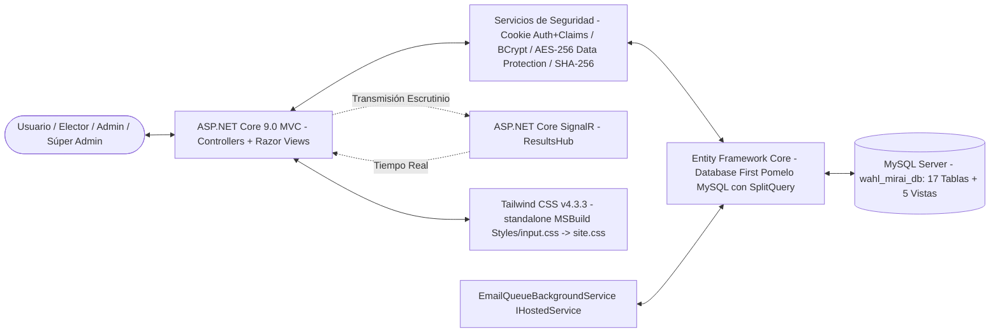
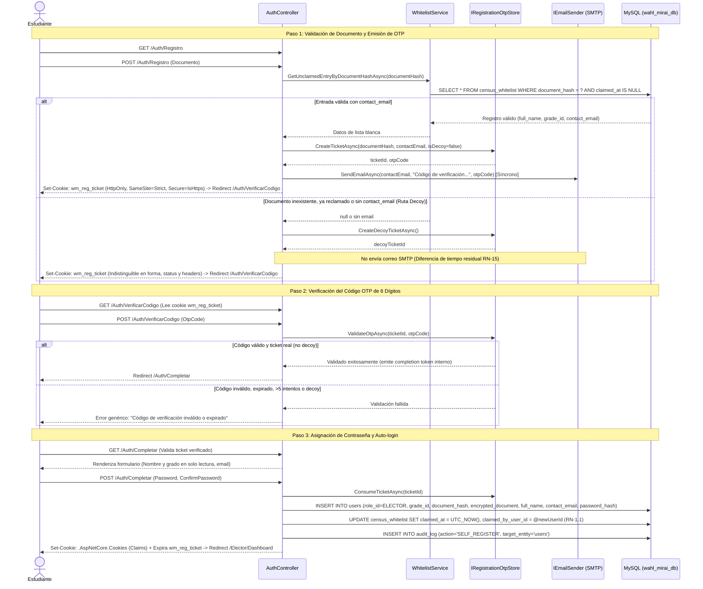
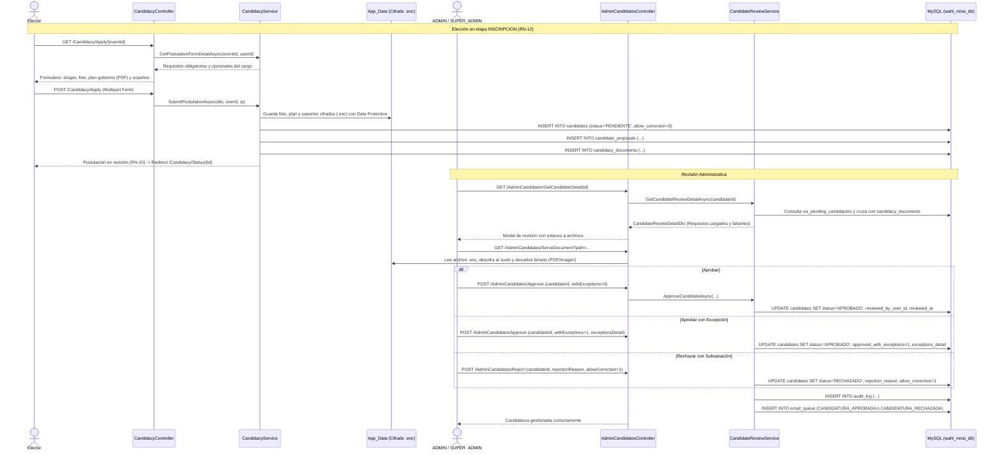
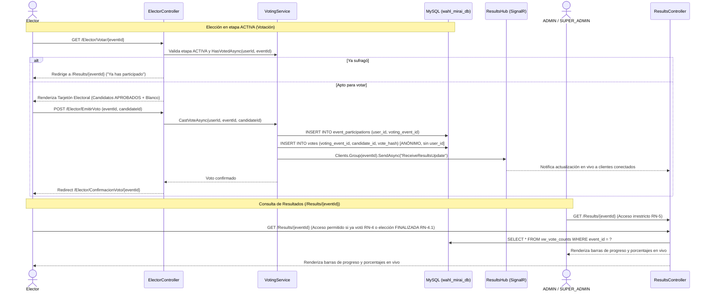

# Arquitectura y Diseño de Software
## Sistema de Votaciones Digitales (Wahl Mirai) — Versión 3.0 (Sincronizada con Implementación Real)

Este documento describe la arquitectura técnica, la estructura real del proyecto en **ASP.NET Core 9.0 MVC** (Razor Views), el modelo de datos relacional (17 tablas físicas y 5 vistas MySQL optimizadas) y los flujos de control del sistema de elecciones **Wahl Mirai**, alineado fielmente con el código fuente y las reglas de negocio de **ERS v3.0**.

> **Nota de sincronización técnica (v3.0):** Esta versión incorpora y formaliza las siguientes capacidades arquitectónicas:
> 1. **Sesión Única Activa y Revocación Inmediata de Acceso en Memoria (RN-14):** Control de sesiones concurrentes e invalidación inmediata de acceso al modificar estado, dar de baja lógica o reasignar contraseñas, operando 100% en RAM mediante `IActiveSessionStore` y `CookieAuthenticationEvents.OnValidatePrincipal`, sin requerir alteraciones al esquema MySQL.
> 2. Mapeo de identidad en Entity Framework Core: la base de datos MySQL implementa las tablas normalizadas `users` y `event_participations`, mientras que el modelo de dominio en C# las mapea mediante las entidades `Voter` y `VoterEventParticipation` utilizando `entity.ToTable("users")` y `entity.ToTable("event_participations")` para mantener la estabilidad del código base.
> 3. Mapeo formal de 5 Vistas MySQL en DbContext: `vw_active_census`, `vw_pending_whitelist`, `vw_pending_email_queue`, `vw_vote_counts` y la recientemente conectada `vw_pending_candidacies` para optimización de consultas complejas.
> 4. Controladores reales con convención administrativa: `AdminCensusController`, `AdminEventsController`, `AdminCandidatesController`, `AdminAccountsController`, `AdminEmailReportController`, `ElectorController` y `RecuperacionAccesoController`.
> 5. Endpoint de descifrado seguro de documentos y fotos: `/AdminCandidates/ServeDocument?path=...` para archivos `.enc` almacenados fuera de `wwwroot`.
> 6. Stack de frontend: compilación MSBuild de Tailwind CSS v4 hacia `site.css`, SignalR en `/hubs/resultsHub`, motor de reglas para Chatbot FAQ, internacionalización en 6 idiomas con diseño dividido (`locale-core.js` + `locale.<lang>.js`, con idioma decidido por el servidor mediante cookie `CurrentCulture`) y persistencia de tema claro/oscuro (`theme.js`).
> 7. Corrección de i18n compartido: el motor de traducción del cliente ahora revisa también `aria-label`, mantiene el observer activo en todas las culturas, aplica coincidencias dinámicas con regex para contadores, asteriscos de obligatoriedad y fechas, sincroniza `lang` del HTML en cada cambio de idioma y expone el selector de idioma en layouts compartidos para toda la app.
> 8. **Auto-registro Seguro con Verificación OTP y Lista Blanca (v3.0):** Flujo de auto-registro en tres pasos con validación estricta de posesión de correo preautorizado en `census_whitelist.contact_email` mediante código OTP de 6 dígitos generado con CSPRNG y almacenado con hash SHA-256 en memoria (`IRegistrationOtpStore`), ticket criptográfico efímero de 32 bytes en cookie segura `wm_reg_ticket`, respuestas indistinguibles ante documentos inexistentes/reclamados/sin correo mediante tickets señuelo (decoy), y revelación de identidad personal (nombre y grado) exclusivamente tras la validación exitosa del código OTP.

## Comprobación permanente de cobertura i18n y Localización de Alertas/AJAX

La herramienta `scripts/check-i18n-coverage.ps1` actúa como Gate de Calidad de Internacionalización continuo. Recorre exhaustivamente las vistas Razor (`.cshtml`), los scripts JavaScript del cliente (`wwwroot/js/*.js`) y las respuestas JSON de los controladores MVC (`Controllers/*.cs`). Compara cada cadena extraída contra las claves exactas de los diccionarios divididos `wwwroot/js/locale.<lang>.js` en los 5 idiomas objetivo (`en`, `de`, `fr`, `ja` y `zh`).

### Estándar de Localización de Alertas, Modales y Respuestas Asíncronas (AJAX)
1. **Intercepción Global No Intrusiva de `window.alert` y `window.confirm`:** En `locale-core.js`, los diálogos nativos del navegador se interceptan automáticamente para consultar `window.translateText(msg)` en tiempo de ejecución. De este modo, cualquier confirmación inline (e.g. `onsubmit="return confirm('...');"`) o alerta JavaScript emitida desde librerías o controladores frontend se traduce inmediatamente al idioma activo del usuario.
2. **Localización de Respuestas JSON de Controladores:** Los controladores que devuelven respuestas JSON (como `ProfileController` y `PqrController` con contratos `{ ok = bool, message = string }`) emiten mensajes en español estándar que cuentan con equivalencia exacta en los diccionarios del cliente. En las vistas y scripts AJAX, los bloques de resultado procesan la respuesta mediante `translateText(data.message)`.
3. **Formateo Reactivo de Fechas y Horas:** Los componentes dinámicos y modales asíncronos (e.g. historial de PQR, detalle de lista blanca en `PendingWhitelist`) emplean `Intl.DateTimeFormat(currentLocale, ...)` o `date.toLocaleString(currentLocale)` sincronizados reactivamente con el cookie de cultura activo, eliminando literales estáticos en español (como `'es-ES'`).
4. **Validación de Cero Duplicados:** Las ampliaciones modulares de diccionarios (`EXTRA_TRANSLATIONS`, `ajaxAndModalTranslations`, `chatbotDraftTranslations`) se validan con `scripts/verify-duplicates.ps1` para garantizar unicidad estricta y evitar sobreescrituras accidentales.


### Herramientas auxiliares y entorno local

La carpeta `scripts/` pertenece a la raíz del repositorio y contiene automatizaciones de mantenimiento que no forman parte del runtime web:

* `check-i18n-coverage.ps1`: auditoría de cobertura de textos visibles, atributos de interfaz, alerts, confirms y mensajes JSON de controladores contra los diccionarios segmentados `locale.<lang>.js`.
* `verify-duplicates.ps1`: verificación de unicidad estricta (cero duplicados) en las claves de los diccionarios para todos los idiomas.
* `i18n-common.ps1`: funciones compartidas para leer las claves de los diccionarios y detectar traducciones faltantes.
* `missing-strings-export.json`: exportación de cadenas que requieren revisión o traducción.
* `missing-strings-filtered-out.json`: registro de coincidencias excluidas por ser rutas, código, fragmentos dinámicos o falsos positivos documentados.

Estas herramientas se ejecutan desde la raíz, por ejemplo `powershell -NoProfile -ExecutionPolicy Bypass -File .\scripts\check-i18n-coverage.ps1`; ninguna de estas herramientas se invoca en tiempo de ejecución por la aplicación.

### Navegación por contexto

`_Layout.cshtml` renderiza la cabecera global (`_SiteHeader`) con marca, idioma, tema, autenticación y el favicon/navicon institucional (`logo.png`). La identidad de marca en cabecera actúa como retorno canónico principal, ofreciendo acceso directo a `Ayuda` tanto en escritorio como en dispositivos móviles. `_ElectorLayout.cshtml` y `_AdminLayout.cshtml` agregan exclusivamente la navegación de su rol cuando el usuario entra a módulos protegidos. Esta separación evita mezclar acciones administrativas con navegación pública, elimina duplicidades de marca en el menú lateral y permite que una sesión iniciada visite la portada sin heredar el menú del elector o del administrador.

En `_AdminLayout.cshtml`, el estado activo se determina por controlador y acción: `Pqr/Index` activa `Ayuda`, mientras `Pqr/Manage` activa únicamente `Gestión PQR`. No se debe marcar todo el controlador `Pqr` como ayuda porque eso produce dos elementos activos en la gestión administrativa.

Para garantizar una única región de desplazamiento vertical sin desbordamiento externo (`double scrollbar`), el contenedor raíz de `_AdminLayout.cshtml` calcula su altura exactamente como el viewport dinámico menos la cabecera en flujo (`h-[calc(100dvh-4rem)]`), delegando el scroll exclusivamente al área interna de contenido (`overflow-y-auto`). Asimismo, la regla de fondo en `theme.css` excluye elementos con posicionamiento intencional (`.voting-pattern-bg > :not(.fixed, .absolute, .sticky)`), permitiendo que modales y diálogos fijados al viewport mantengan `position: fixed` sin ser degradados a `position: relative`.

### Rendimiento del módulo PQR

Las consultas de `PqrController` para `Mine` y `List` son de solo lectura y usan `AsNoTracking()`. `List` proyecta los campos requeridos por la tabla y obtiene el nombre del votante mediante la relación SQL, sin cargar la entidad relacionada completa. El endpoint implementa paginación y búsqueda parcial insensible a mayúsculas server-side sobre `Voter.FullName` y `Subject` (`status`, `search`, `page`, `pageSize` acotado a 1..100) con ordenamiento determinista por `CreatedAt DESC` y desempate por `Id DESC`, devolviendo el contrato JSON estructurado con `PagedResult<T>` (`ok`, `items`, `totalCount`, `pageNumber`, `pageSize`, `totalPages`, `hasPreviousPage`, `hasNextPage`). En el frontend, `pqr-manage.js` delega la búsqueda y paginación al servidor, gestiona la concurrencia con tokens de petición para descartar respuestas desfasadas, y la vista `Manage.cshtml` expone buscador y controles de paginación accesibles y adaptables a móviles. Los scripts se sirven con `asp-append-version` para prevenir problemas de caché.


---

## 1. Arquitectura del Sistema

El sistema se desarrolla como una aplicación **ASP.NET Core 9.0 MVC** con **Razor Views** renderizadas en servidor, con capas administrativa y de elector diferenciadas mediante layouts dinámicos (`_AdminLayout` / `_ElectorLayout`). La persistencia y el acceso a datos se gestionan mediante **Entity Framework Core (Database First)** con **Pomelo.EntityFrameworkCore.MySql** sobre **MySQL/XAMPP**:



* **Tecnologías de Frontend:**
  * **Razor Views** semánticas y accesibles, renderizadas en servidor con soporte de localización multi-idioma (`IViewLocalizer`).
  * **Tailwind CSS v4.3.3**, compilado localmente en tiempo de compilación mediante el binario standalone (`tailwindcss.exe` descargado por MSBuild), procesando la hoja `Styles/input.css` hacia `wwwroot/css/site.css`, que ya no se versiona en Git y se regenera localmente en cada build. Usa el sistema de tokens semánticos institucional (`--color-primary`, `--color-status-*`) y soporte de modo oscuro con `@custom-variant dark`.
  * **Vanilla JS (ES6+):**
    * `theme.js`: Manejo de tema visual claro/oscuro persistente en `localStorage`.
    * `locale-core.js` + `locale.<lang>.js`: Arquitectura modular de traducción en cliente para 6 idiomas (`es`, `en`, `de`, `fr`, `ja`, `zh`), donde el motor central (`locale-core.js`) gestiona el DOM y mutaciones, mientras que el diccionario correspondiente se carga de forma selectiva según la cultura del servidor.
    * `ayuda-chatbot.js`: Motor conversacional FAQ por reglas cliente con búsqueda por palabras clave, lightbox para infografías y escalamiento a PQR con persistencia en `sessionStorage`.
    * `auth-completar.js`: Medidor en tiempo real de complejidad de contraseñas para auto-registro.
    * `pqr-manage.js`: Gestión asíncrona (AJAX) del panel administrativo de PQR.
  * **ASP.NET Core SignalR:** Cliente JavaScript en la vista de resultados suscrito al canal `/hubs/resultsHub` (`ReceiveResultsUpdate`) para actualización en tiempo real de votos y porcentajes.

* **Tecnologías de Backend:**
  * **C# 13** sobre **.NET 9.0 / ASP.NET Core MVC**.
  * **Cookie Authentication con Claims y Sesión Única Activa (RN-14):** Manejo de sesión mediante cookie firmada (`CookieAuthenticationDefaults.AuthenticationScheme`), con expiración de 2 horas y claims de identidad (`NameIdentifier`, `Name`, `Role`, `Grade`, `SessionStamp`).
  * **Validación e Invalidación en Tiempo Real (`OnValidatePrincipal`):** Interceptor en `Program.cs` que en cada solicitud HTTP:
    1. Verifica en memoria contra `IActiveSessionStore` que el claim `SessionStamp` coincida con el stamp activo del usuario.
    2. Consulta en base de datos (`AsNoTracking`, proyectando solo `Status` y `DeletedAt`) que la cuenta permanezca en estado `ACTIVO` y `deleted_at == null`.
    3. Ante discrepancia de stamp o estado no activo, ejecuta `context.RejectPrincipal()`, `SignOutAsync("Cookies")` y redirige a `/Auth/Login?reason=device` (sesión reemplazada por nuevo dispositivo) o `/Auth/Login?reason=disabled` (cuenta desactivada/eliminada).
    4. `OnRedirectToLogin` preserva el parámetro `?reason=` ante desafíos de autorización (`[Authorize]`).
  * **Decisión de Diseño de Cero Cambios en MySQL:** Todo el control de sesión única y revocación opera en memoria de aplicación (RAM) mediante `IActiveSessionStore` respaldado por `ConcurrentDictionary<uint, SessionEntry>`, siguiendo el patrón desacoplado y de alto rendimiento ya empleado por `PendingPasswordStore`. No se alteró el esquema relacional ni se agregaron columnas a MySQL.
  * **Políticas de Autorización:**
    * Política `"ADMIN"`: Requiere roles `ADMIN` o `SUPER_ADMIN`.
    * Política `"ELECTOR"`: Requiere rol `ELECTOR`.
    * Exclusividad `SUPER_ADMIN`: Aplicada en `AdminAccountsController` mediante `[Authorize(Roles = "SUPER_ADMIN")]`.
  * **Middleware Personalizado:** `UseForcePasswordChange()` es un stub de paso directo (pass-through) conservado desde la versión v2.3; no intercepta peticiones activamente para forzar cambio de credenciales en el primer acceso.
  * **Entity Framework Core (Database First):** ORM mediante **Pomelo.EntityFrameworkCore.MySql** (v9.0.0). Configuración global de `QuerySplittingBehavior.SplitQuery` para mitigar la explosión cartesiana en relaciones 1:N complejas (eventos $\rightarrow$ grados $\rightarrow$ candidatos $\rightarrow$ propuestas $\rightarrow$ soportes).
  * **Servicios de Seguridad, Sesión y Cifrado:**
  * **Almacén de Sesión Única (`IActiveSessionStore` / `ActiveSessionStore`):** Servicio Singleton respaldado por un diccionario concurrente en memoria (`ConcurrentDictionary<uint, SessionEntry>`). Administra los estados mediante el enum `SessionInvalidationReason` (`ReplacedByNewDevice`, `AccountDisabledOrDeleted`, `LoggedOut`). Permite registrar stamps, validar vigencia y forzar invalidaciones inmediatas en microsegundos sin sobrecargar el motor de base de datos.
  * **Almacén de Tokens de Restablecimiento (`IPasswordResetTokenStore` / `PasswordResetTokenStore`):** Servicio Singleton respaldado en memoria (`IMemoryCache`) con expiración fija de 30 minutos y consumo atómico de un solo uso (`TryConsume`) o inspección no destructiva (`TryPeek`, RN-15). Soporta revocación por usuario (`Revoke`). El flujo de recuperación en `CredentialService` emite tokens criptográficos para `RECUPERACION_ACCESO` y completa el cambio de clave mediante `CompletePasswordResetAsync`, actualizando `password_hash` con BCrypt, revocando sesiones previas en `IActiveSessionStore` (`LoggedOut`, RN-14), limpiando bloqueos de login en `ILoginAttemptStore` (`RegisterSuccess`, RN-15) y asentando auditoría forense (`PASSWORD_RECOVERY_REQUESTED`, `PASSWORD_RESET_COMPLETED`).
  * **Almacén de OTP y Tickets de Registro (`IRegistrationOtpStore` / `RegistrationOtpStore`):** Servicio Singleton respaldado en memoria (`IMemoryCache`) con expiración fija de 15 minutos (`OtpTtlMinutes = 15`), límite estricto de 5 intentos fallidos (`MaxFailedAttempts = 5`), cooldown de emisión de 60 segundos por entrada (`CooldownSeconds = 60`) y emisión de tickets señuelo (decoy) de 32 bytes en hex para mitigar enumeración. Administra el ciclo de vida del ticket de registro y la validación de códigos de un solo uso mediante comparación criptográfica de tiempo constante (`CryptographicOperations.FixedTimeEquals`).
  * **Cookie de Ticket de Registro (`wm_reg_ticket`):** Cookie de sesión efímera que transporta el ticket de auto-registro emitido por `IRegistrationOtpStore`. Se configura con `HttpOnly = true`, `SameSite = SameSiteMode.Strict`, `MaxAge = TimeSpan.FromMinutes(15)` y `Secure = Request.IsHttps` (condicionado a que la petición sea HTTPS). Al completarse o abortarse el registro, se elimina explícitamente con las mismas banderas.
  * **Configuración BaseUrl para Enlaces de Correo (`EmailSettings:BaseUrl`):** Clave de configuración obligatoria para construir enlaces absolutos canónicos hacia `/RecuperacionAcceso/Restablecer?token=...`. Opera en modo fail-closed: si está vacía o ausente, la emisión de tokens para recuperación lanza `InvalidOperationException` impidiendo despachar correos con enlaces rotos. En desarrollo se configura mediante `user-secrets` o `appsettings.Development.json`; en producción mediante la variable de entorno `EmailSettings__BaseUrl` (e.g. `https://votaciones.colegio.edu.co`).
  * **Protección contra Fuerza Bruta (`ILoginAttemptStore` / `LoginAttemptStore`):** Servicio Singleton en memoria respaldado por `ConcurrentDictionary<string, LoginAttemptEntry>` para mitigar ataques de fuerza bruta (RN-15). Implementa ventana de 15 minutos, escalera de bloqueo progresivo (1m, 5m, 15m, persistiendo en 15m), sincronización `lock(entry)` por entrada y depuración perezosa (lazy purge) al superar 5000 registros. Sus buckets son independientes: login (`document_hash`, umbral 5), perfil (`profile:{userId}`, umbral 5) y auto-registro (`register:{clientIpKey}`, umbral configurable 30 por defecto particionado con `ClientIpKey`); el último no se limpia ante una alta exitosa porque agrupa a todos los usuarios tras un NAT escolar. Ante direcciones IP nulas, la clave se normaliza a `register:unknown` (unificando la anterior grafía `register:Unknown`).
  * **Normalización de Claves de Partición IP (`ClientIpKey`):** Módulo estático transversal (`WahlMirai.Web.Services.ClientIpKey`) que normaliza direcciones IP en claves de partición determinísticas para `RateLimiting` (`AuthLogin`, `AuthRecovery`, `AuthRegister`) y para el bucket de fallos de auto-registro (`register:{clientIpKey}`). Aplica el siguiente orden estricto de reglas:
    1. `null` o sin conexión: retorna `"unknown"`.
    2. IPv4 asignada a IPv6 (`IsIPv4MappedToIPv6`, e.g. `::ffff:x.x.x.x`): se mapea inmediatamente a IPv4 mediante `.MapToIPv4()` antes de la validación de familia, evitando que todos los clientes IPv4 bajo sockets dual-stack colapsen en un único prefijo `/64`.
    3. IPv4 nativa: se conserva en su formato canónico `/32` (`address.ToString()`, e.g. `192.0.2.30`).
    4. IPv6 nativa: toma los primeros 8 bytes (prefijo /64) y establece en cero los 8 bytes restantes, descartando cualquier identificador de ámbito (`scope id`, `%scope`), retornando la cadena canónica más `"/64"` (e.g. `2001:db8:1:2::abcd` -> `"2001:db8:1:2::/64"`, `::1` -> `"::/64"`).
    5. Robustez y valores especiales: no lanza excepciones en ninguna circunstancia (`127.0.0.1` -> `"127.0.0.1"`, `::1` -> `"::/64"`).
    * **Separación estricta de auditoría:** `ClientIpKey` se utiliza **única y exclusivamente** para el particionamiento de límites de tasa y bloqueo de intentos. Las tablas y registros de auditoría forense (`audit_log` en base de datos) preservan siempre la dirección IP cruda observada (`RemoteIpAddress`) para mantener trazabilidad judicial e investigación de incidentes.
  * **Rate Limiting y Protección DoS/Fuerza Bruta:** Middleware `Microsoft.AspNetCore.RateLimiting` con políticas `AuthLogin` (180), `AuthRecovery` (30) y `AuthRegister` (180 peticiones/min) particionadas por `ClientIpKey.From(httpContext)` (IPv4 /32 e IPv6 /64), con respuesta HTTP 429 (`Retry-After: 60`). `AuthRecovery` protege GET/POST `/RecuperacionAcceso/Recuperar` y GET/POST `/RecuperacionAcceso/Restablecer`; `AuthRegister` aplica a GET/POST `/Auth/Registro`, GET/POST `/Auth/VerificarCodigo`, POST `/Auth/ResendOtp` y GET/POST `/Auth/Completar`; es un límite de flood generoso para NAT compartido, mientras que el bucket `register:{clientIpKey}` es la defensa por fallos.
  * **Cabeceras Reenviadas y Proxy Inverso (`ForwardedHeadersConfiguration`):** Middleware `UseForwardedHeaders()` configurable, opt-in y fail-closed (`ForwardLimit = 1`, solo `X-Forwarded-For` y `X-Forwarded-Proto`, sin `X-Forwarded-Host`). Se ejecuta como primer componente del pipeline HTTP (antes de `UseRequestLocalization`, `UseExceptionHandler`, `UseHsts`, `UseHttpsRedirection` y `UseRateLimiter`).
    * **Tabla de configuración por topología:**

| Topología | `Enabled` | `KnownProxies` | `KnownNetworks` | Notas / Comportamiento |
|---|---|---|---|---|
| **Sin proxy (exposición directa)** | `false` | `[]` | `[]` | No se procesan cabeceras. `RemoteIpAddress` observa el socket directo; previene IP spoofing. |
| **Proxy local (Nginx/Apache en mismo host)** | `true` | `["127.0.0.1", "::1"]` | `[]` | Confía exclusivamente en el proxy ejecutado en loopback local. |
| **Proxy remoto / Balanceador dedicado (1 salto)** | `true` | `["10.0.0.5"]` | `["10.0.0.0/24"]` | IP exacta o prefijo CIDR del proxy/balanceador privado. |
| **Dos saltos (CDN / WAF + Proxy interno)** | `true` | Ambas IPs listadas | Rangos CDN + proxy | **Advertencia:** El código actual fija `ForwardLimit = 1` y consume solo el último salto confiable; para confiar en dos saltos se requeriría parametrizar `ForwardLimit = 2`. |

    * **Mitigación de Spoofing:** El proxy inverso debe sobrescribir `X-Forwarded-For` con `$remote_addr` (no concatenar a ciegas valores previos del cliente).
    * **Variable de entorno:** `ASPNETCORE_FORWARDEDHEADERS_ENABLED` **NO debe estar definida en el despliegue**, ya que su activación limpia las listas de confianza y confía ciegamente en cualquier origen.
  * **Seguridad de Cookies:** `Cookie.SecurePolicy` configurado explícitamente a `CookieSecurePolicy.Always` en producción (`SameAsRequest` en desarrollo).
  * **Mitigación de Timing Attacks:** En login, se evalúa `BCrypt.Verify` contra un hash dummy en caso de cuentas no encontradas o bloqueadas para evitar inferencia de existencia o estado mediante discrepancias de tiempo. Junto al error genérico, la vista presenta la pista estática 'Si fallaste varias veces, tu acceso puede estar bloqueado temporalmente. Espera unos minutos e intenta de nuevo.' ante todos los fallos, sin indicar si el bloqueo está activo.
  * **Hashing de contraseñas:** **BCrypt** (factor de trabajo 11); se aplica en el auto-registro del estudiante (RF-M01-00), restablecimiento de acceso mediante token (RF-M01-02) y reasignación administrativa (RF-M07-02, RF-M09-01).
  * **Hash determinístico de documento (`document_hash`):** **SHA-256**, `CHAR(64)`, indexado de manera única para validaciones anti-duplicado y login sin exponer el documento plano.
  * **Cifrado reversible de documento (`encrypted_document`):** **AES-256** vía ASP.NET Core Data Protection API (`IDocumentEncryptionService`), persistido en la carpeta `keys/`. Auto-migración idempotente al arranque de la aplicación para cifrar documentos semilla en texto plano.
  * **Cifrado de Archivos de Candidatura:** Fotos, planes de gobierno y soportes documentales se almacenan cifrados (`.enc`) en `App_Data/candidacy-uploads/candidacies/` fuera de `wwwroot`. Se sirven exclusivamente a administradores autorizados mediante el endpoint seguro `GET /AdminCandidates/ServeDocument?path=...`.
  * **Riesgos Residuales y Decisiones de Arquitectura:**
    1. *Almacenamiento en Memoria (RAM):* Tanto `IActiveSessionStore`, `ILoginAttemptStore`, `IPasswordResetTokenStore`, `IRegistrationOtpStore` e `IMemoryCache` operan en memoria local del proceso. Un reinicio de la aplicación reinicia contadores de intentos fallidos, bloqueos, sesiones, tickets de auto-registro y tokens efímeros de recuperación pendientes. No es apto para scale-out (múltiples instancias detrás de un balanceador) sin migrar a un almacén distribuido (Redis).
    2. *Denegación Dirigida:* Al bloquear cuentas por documento, un atacante que conozca el número de documento de un estudiante puede bloquearlo deliberadamente. Por diseño, el flujo de recuperación de acceso (RF-M01-02) es independiente y no se bloquea por el estado de login.
    3. *NAT Compartido Escolar:* Las restricciones de tasa por IP (`RemoteIpAddress` y `ClientIpKey`) agrupan a todos los dispositivos que salen por una misma IP pública en la red escolar, incluso tras proxy inverso (ya que el proxy reenvía la IP pública compartida). Los límites deben calibrarse tras pruebas de carga para evitar falsos positivos durante picos electorales.
    4. *Mitigación de Enumeración en Auto-registro y Diferencia de Temporización:* El flujo de auto-registro con OTP mitiga la revelación de datos personales al no exponer el nombre ni el grado hasta que el código de verificación haya sido validado. Las respuestas ante documentos válidos, no encontrados o ya reclamados son indistinguibles en código de estado HTTP (302), cuerpo y estructura de cookie. Sin embargo, existe el riesgo residual de diferencia de temporización (timing attack) debido a que el despacho SMTP hacia el servidor de correo se realiza de forma síncrona en el flujo válido, mientras que en el señuelo (decoy) no se efectúa envío de correo (no se introducen retardos artificiales para evitar riesgos de DoS y agotamiento de hilos). Asimismo, el bucket por IP (`register:{clientIpKey}`) no detiene atacantes con capacidad de rotación de direcciones IP públicas.
    5. *Rotación en Prefijos Delegados IPv6 mayores a /64:* El agrupamiento de clientes IPv6 a nivel /64 mitiga la rotación de direcciones temporales o SLAAC en la interfaz del cliente. No obstante, existe el riesgo residual de que un atacante disponga de un prefijo asignado mayor (por ejemplo, /56 con 256 subredes o /48 con 65.536 subredes), lo que le permitiría saltar de subred /64 para evadir el rate limiter o el contador de fallos.
    6. *Checklist de Despliegue para BaseUrl:* Antes de habilitar el servicio de correo en producción, es obligatorio configurar `EmailSettings__BaseUrl` con la URL canónica pública (HTTPS) de la institución educativa. Si se omite, cualquier solicitud de recuperación fallará de inmediato (fail-closed).
    7. *Dependencia de `Request.IsHttps` en la Cookie de Ticket (`wm_reg_ticket`):* La bandera `Secure` de la cookie de registro se establece dinámicamente según `Request.IsHttps`. En despliegues detrás de un proxy inverso con terminación TLS, si `ForwardedHeadersConfiguration` no está debidamente habilitado o configurado para confiar en el proxy, `Request.IsHttps` podría evaluarse como `false`, emitiendo la cookie sin la bandera `Secure`. Es crítico asegurar la correcta configuración de cabeceras reenviadas en producción. en producción, es obligatorio configurar `EmailSettings__BaseUrl` con la URL canónica pública (HTTPS) de la institución educativa. Si se omite, cualquier solicitud de recuperación fallará de inmediato (fail-closed).

---

## 2. Estructura de Directorios del Proyecto

```
WahlMirai.Web/
│
├── Controllers/
│   ├── AdminAccountsController.cs    # Gestión de cuentas ADMIN/SUPER_ADMIN (M09, exclusivo Súper Admin)
│   ├── AdminCandidatesController.cs  # Revisión de candidaturas (aprobar, rechazar, retirar) y ServeDocument (M04)
│   ├── AdminCensusController.cs      # Carga/gestión de Lista Blanca, censo activo, CSV y promoción anual (M02)
│   ├── AdminEmailReportController.cs # Monitoreo de cola y reporte de entrega de correos electrónicos (RN-9)
│   ├── AdminEventsController.cs      # CRUD de Elecciones, etapas y requisitos de cargos (M03)
│   ├── AuthController.cs             # Login, Logout, Auto-registro en 2 pasos (Registro/Completar) y CambiarClave (M01)
│   ├── CandidacyController.cs        # Autopostulación de electores (Apply), estado (Status) y dashboard (Index) (M04)
│   ├── ElectorController.cs          # Dashboard de elector, emisión de voto (Votar/EmitirVoto) y propuestas (M05)
│   ├── ErrorController.cs            # Páginas de error HTTP amigables (404, 500, etc.)
│   ├── HomeController.cs             # Portada del sistema y redirecciones según rol autenticado
│   ├── PqrController.cs              # Centro de ayuda (/Ayuda, /Pqr público), creación de PQR y gestión admin (M08)
│   ├── ProfileController.cs          # Autogestión de correo y cambio de clave en 2 pasos (M07)
│   ├── RecuperacionAccesoController.cs # Recuperación anónima de contraseña con anti-enumeración (M01)
│   └── ResultsController.cs          # Escrutinio en vivo, reglas de acceso RN-4/4.1/5 y SignalR (M06)
│
├── Models/
│   ├── WahlMiraiDbContext.cs         # DbContext principal (17 tablas físicas + 5 vistas MySQL)
│   │
│   ├── AcademicYear.cs               # Entidad academic_years (año lectivo y promoción)
│   ├── AuditLog.cs                   # Entidad audit_log (auditoría de operaciones sensibles)
│   ├── CandidacyDocument.cs          # Entidad candidacy_documents (soportes documentales de candidatos)
│   ├── Candidate.cs                  # Entidad candidates (postulaciones, voto en blanco y allow_correction)
│   ├── CandidateProposal.cs          # Entidad candidate_proposals (propuestas de campaña)
│   ├── CensusWhitelist.cs            # Entidad census_whitelist (lista blanca de auto-registro M02/M01)
│   ├── ElectionPosition.cs           # Entidad election_positions (catálogo reutilizable de cargos)
│   ├── EmailQueue.cs                 # Entidad email_queue (cola de correos pendientes/enviados/fallidos)
│   ├── EmailSettings.cs              # Configuración SMTP y límites de tasa
│   ├── EventGrade.cs                 # Entidad event_grades (grados habilitados para cada proceso)
│   ├── Grade.cs                      # Entidad grades (grados escolares en orden secuencial)
│   ├── PositionRequirement.cs        # Entidad position_requirements (requisitos obligatorios/opcionales)
│   ├── PqrTicket.cs                  # Entidad pqr_tickets (tickets PQR radicados y respuestas admin)
│   ├── Role.cs                       # Entidad roles (ELECTOR, ADMIN, SUPER_ADMIN)
│   ├── Roles.cs                      # Constantes de roles para autorización
│   ├── Vote.cs                       # Entidad votes (votos cifrados anónimos con vote_hash)
│   ├── Voter.cs                      # Entidad mapeada a tabla MySQL 'users' (electores y cuentas admin)
│   ├── VoterEventParticipation.cs    # Entidad mapeada a tabla MySQL 'event_participations' (control anti-doble voto)
│   ├── VotingEvent.cs                # Entidad voting_events (procesos electorales y ventanas de etapa)
│   │
│   ├── VwActiveCensu.cs              # Vista MySQL vw_active_census (censo con grado legible)
│   ├── VwPendingCandidacy.cs         # Vista MySQL vw_pending_candidacies (candidaturas pendientes con requisitos)
│   ├── VwPendingEmailQueue.cs        # Vista MySQL vw_pending_email_queue (cola de correo para background worker)
│   ├── VwPendingWhitelist.cs         # Vista MySQL vw_pending_whitelist (entradas no reclamadas de lista blanca)
│   └── VwVoteCount.cs                # Vista MySQL vw_vote_counts (conteo y porcentaje en tiempo real)
│
├── ViewModels/
│   ├── AdminAccountViewModels.cs     # ViewModels para alta y edición de cuentas administrativas (M09)
│   ├── AuthViewModels.cs             # LoginViewModel y ChangePasswordViewModel
│   ├── ErrorViewModel.cs             # Representación de errores en vistas de fallo
│   ├── PagedResult.cs                # Estructura genérica para paginación de listados
│   ├── PqrDtos.cs                    # PqrCreateDto y PqrResponseDto
│   ├── ProfileViewModel.cs           # Perfil de usuario y actualización de contacto (M07)
│   ├── RecuperarAccesoViewModel.cs   # Formulario de solicitud de nueva contraseña
│   └── RegistroViewModels.cs         # RegistroStep1ViewModel, RegistroStep2ViewModel, VerificarCodigoViewModel y ReenviarOtpViewModel
│
├── Services/
│   ├── IActiveSessionStore.cs / ActiveSessionStore.cs # Almacén singleton en memoria de sesión activa y motivos de revocación (RN-14)
│   ├── ILoginAttemptStore.cs / LoginAttemptStore.cs   # Almacén singleton en memoria de intentos fallidos y bloqueo escalonado (RN-15)
│   ├── IRegistrationOtpStore.cs / RegistrationOtpStore.cs # Almacén singleton en memoria de tickets OTP de registro y decoys (RN-15)
│   ├── IAuditService.cs / AuditService.cs             # Registro centralizado de auditoría en audit_log (RN-8)
│   ├── IAuthService.cs (AuthService)                  # Autenticación, hashing SHA-256/BCrypt, timing mitigation y cookie claims
│   ├── ICensusService.cs (CensusService)              # Censo paginado, edición, borrado lógico, lista blanca e invalidación de sesión
│   ├── IVotingService.cs (VotingService)              # Consulta de procesos, emisión de voto y SignalR trigger
│   ├── IPromotionService.cs (PromotionService)        # Algoritmo de promoción anual de grado y egreso
│   ├── IEventService.cs (EventService)                # CRUD de eventos, ventanas de tiempo y cálculo de etapas
│   ├── IProfileService.cs (ProfileService)            # Actualización de datos de perfil, verificación de contraseña con throttling (RN-15), aviso de seguridad al correo anterior y confirmación al nuevo
│   ├── ICandidateReviewService.cs (CandidateReviewService) # Aprobación/Rechazo de candidaturas usando vw_pending_candidacies
│   ├── ICandidacyService.cs (CandidacyService)        # Registro de postulación, plan y carga cifrada de soportes
│   ├── IAdminAccountService.cs (AdminAccountService)  # Operaciones M09 sobre usuarios administrativos e invalidación de sesión
│   ├── IWhitelistService.cs (WhitelistService)        # Validación y reclamo atómico de lista blanca (RN-1.1)
│   ├── IEmailSender.cs / MailKitEmailSender.cs        # Envío SMTP real mediante MailKit con STARTTLS
│   ├── IPendingPasswordStore.cs (PendingPasswordStore)# Almacén temporal en memoria para despacho seguro de credenciales
│   ├── ICredentialService.cs (CredentialService)      # Generación de claves aleatorias y encolamiento
│   ├── IDocumentEncryptionService.cs (DocumentEncryptionService) # AES-256 Data Protection (Singleton)
│   ├── ForwardedHeadersConfiguration.cs               # Configuración estricta opt-in y fail-closed de proxy inverso
│   ├── ClientIpKey.cs                                # Normalización de claves IP para rate limiting y lockout (IPv4 /32, IPv6 /64)
│   └── EmailQueueBackgroundService.cs                 # BackgroundService para despacho progresivo (RN-9)
│
├── Hubs/
│   └── ResultsHub.cs                 # Hub SignalR (/hubs/resultsHub) para actualización en vivo de escrutinio
│
├── Middleware/
│   └── ForcePasswordChangeMiddleware.cs # Interceptor que redirige a CambiarClave si la contraseña es temporal
│
├── Styles/
│   └── input.css                     # Entrada de Tailwind CSS v4 con tokens de diseño semánticos y modo oscuro
│
├── Views/
│   ├── AdminAccounts/                # Index.cshtml (gestión Súper Admin)
│   ├── AdminCandidates/              # Index.cshtml (revisión de postulaciones)
│   ├── AdminCensus/                  # Index.cshtml, PendingWhitelist.cshtml (gestión de censo y lista blanca)
│   ├── AdminEmailReport/             # Index.cshtml (panel de monitoreo de correos)
│   ├── AdminEvents/                  # Index.cshtml, Form.cshtml, Edit.cshtml, _ConfigurePersonas.cshtml
│   ├── Auth/                         # Login.cshtml, Registro.cshtml, VerificarCodigo.cshtml, Completar.cshtml, CambiarClave.cshtml
│   ├── Candidacy/                    # Index.cshtml, Apply.cshtml, Status.cshtml (autopostulación de electores)
│   ├── Elector/                      # Dashboard.cshtml, Votar.cshtml, Propuestas.cshtml, ConfirmacionVoto.cshtml
│   ├── Error/                        # 404.cshtml, 500.cshtml
│   ├── Home/                         # Index.cshtml (portada y bienvenida)
│   ├── Pqr/                          # Index.cshtml (Ayuda + Chatbot), Create.cshtml, Manage.cshtml
│   ├── Profile/                      # Index.cshtml (perfil y modal de 2 pasos)
│   ├── RecuperacionAcceso/           # Recuperar.cshtml, Exito.cshtml
│   ├── Results/                      # Index.cshtml (gráficas de escrutinio en tiempo real con SignalR)
│   └── Shared/                       # _AdminLayout.cshtml, _ElectorLayout.cshtml, _ValidationScriptsPartial.cshtml
│
├── App_Data/
│   └── candidacy-uploads/candidacies/ # Almacén seguro fuera de wwwroot de archivos .enc (fotos, planes, soportes)
│
├── keys/                             # Llaves criptográficas de ASP.NET Core Data Protection
│
└── wwwroot/
    ├── css/
    │   └── site.css                  # Hoja de estilos procesada y minificada por Tailwind CSS v4
    ├── img/
    │   └── ayuda/                    # Ilustraciones SVG oficiales del módulo M08 (RF-M08-00)
    │       ├── ayuda-login.svg
    │       ├── ayuda-perfil.svg
    │       ├── ayuda-postulacion.svg
    │       ├── ayuda-recuperar.svg
    │       ├── ayuda-registro.svg
    │       ├── ayuda-resultados.svg
    │       └── ayuda-votar.svg
    ├── images/                       # Assets estáticos (default-avatar.png, login-background.jpg, etc.)
    └── js/
        ├── auth-completar.js         # Medidor de fuerza de clave y validación interactiva de auto-registro
        ├── ayuda-chatbot.js          # Chatbot conversacional FAQ por reglas cliente con escalamiento a PQR
        ├── locale-core.js            # Motor de traducción i18n cliente y observador de mutaciones
        ├── locale.es.js              # Diccionario de español (claves dinámicas)
        ├── locale.en.js              # Diccionario de inglés
        ├── locale.de.js              # Diccionario de alemán
        ├── locale.fr.js              # Diccionario de francés
        ├── locale.ja.js              # Diccionario de japonés
        ├── locale.zh.js              # Diccionario de chino
        ├── pqr-manage.js             # Panel interactivo para resolución y filtrado de PQR
        ├── site.js                   # Scripts generales
        └── theme.js                  # Conmutador y persistencia de tema claro/oscuro
```

---

## 3. Modelo de Datos (17 Tablas Físicas y 5 Vistas MySQL)

El modelo de base de datos relacional opera sobre el esquema `wahl_mirai_db`.

```mermaid
erDiagram
    roles ||--o{ users : "asigna_rol"
    grades ||--o{ users : "pertenece_a_grado"
    grades ||--o{ census_whitelist : "pertenece_a_grado"
    users ||--o{ census_whitelist : "carga_lista_blanca"
    users |o--o| census_whitelist : "reclama_registro"
    grades ||--o{ event_grades : "habilitado_en"
    election_positions ||--o{ position_requirements : "define_requisitos"
    election_positions ||--o{ voting_events : "clasifica_cargo"
    voting_events ||--o{ event_grades : "clasifica_grados"
    users ||--o{ email_queue : "receptores_cola"
    users ||--o{ voting_events : "creado_por"
    voting_events ||--o{ candidates : "recibe_postulaciones"
    users |o--o{ candidates : "se_autopostula"
    users ||--o{ candidates : "revisa_candidatura"
    candidates ||--o{ candidate_proposals : "posee_propuestas"
    candidates ||--o{ candidacy_documents : "adjunta_soportes"
    position_requirements ||--o{ candidacy_documents : "exige_soporte"
    voting_events ||--o{ votes : "recibe_votos"
    candidates ||--o{ votes : "acumula_votos"
    users ||--o{ event_participations : "registra_participacion"
    voting_events ||--o{ event_participations : "rastrea_emision"
    users ||--o{ audit_log : "ejecuta_accion"
    users ||--o{ pqr_tickets : "crea_ticket"
    users |o--o{ pqr_tickets : "resuelve_ticket"

    roles {
        TINYINT id PK
        VARCHAR_30 name "ELECTOR, ADMIN, SUPER_ADMIN"
        VARCHAR_100 description
    }

    academic_years {
        SMALLINT id PK
        SMALLINT year "UK"
        TINYINT_1 is_current
        DATETIME promotion_executed_at
        DATETIME created_at
    }

    grades {
        TINYINT id PK
        VARCHAR_10 name "UK"
        TINYINT sequence_order "UK"
        TINYINT_1 is_last_grade
    }

    census_whitelist {
        INT id PK
        CHAR_64 document_hash "UK"
        VARCHAR_500 encrypted_document
        VARCHAR_150 full_name
        VARCHAR_150 contact_email "Nullable"
        TINYINT grade_id FK
        TINYINT_1 excluir_de_promocion
        DATETIME claimed_at "NULL = no reclamado"
        INT claimed_by_user_id FK "Nullable"
        INT uploaded_by_user_id FK
        DATETIME created_at
    }

    users {
        INT id PK
        TINYINT role_id FK
        TINYINT grade_id FK "NULL para cuentas administrativas"
        CHAR_64 document_hash "UK"
        VARCHAR_500 encrypted_document
        VARCHAR_150 full_name
        VARCHAR_150 contact_email
        VARCHAR_255 password_hash
        VARCHAR_100 position_title "Solo ADMIN/SUPER_ADMIN"
        TINYINT_1 excluir_de_promocion
        ENUM status "ACTIVO, INACTIVO, ELIMINADO, EGRESADO"
        DATETIME deleted_at
        DATETIME registered_at
        DATETIME updated_at
    }

    email_queue {
        BIGINT id PK
        INT user_id FK
        ENUM email_type "RECUPERACION_ACCESO, REASIGNACION_ADMIN, CAMBIO_PERFIL, RESPUESTA_PQR, CANDIDATURA_APROBADA, CANDIDATURA_RECHAZADA"
        ENUM status "PENDIENTE, ENVIADO, FALLIDO"
        TINYINT attempts
        TEXT error_message
        DATETIME created_at
        DATETIME sent_at
    }

    election_positions {
        INT id PK
        VARCHAR_100 name "Personero, Contralor, etc."
        TEXT description
        ENUM status "ACTIVO, INACTIVO"
        DATETIME created_at
    }

    position_requirements {
        INT id PK
        INT position_id FK
        VARCHAR_255 description
        TINYINT_1 is_mandatory
        TINYINT display_order
    }

    voting_events {
        INT id PK
        INT created_by_user_id FK
        INT position_id FK
        VARCHAR_200 title
        ENUM election_type "PERSONAS, TEMAS"
        DATE registration_start_date
        TIME registration_start_time
        DATE registration_end_date
        TIME registration_end_time
        DATE proposals_start_date
        TIME proposals_start_time
        DATE proposals_end_date
        TIME proposals_end_time
        DATE voting_start_date
        TIME voting_start_time
        DATE voting_end_date
        TIME voting_end_time
        ENUM status "PROGRAMADA, INSCRIPCION, PROPUESTAS, ACTIVA, FINALIZADA, ELIMINADO"
        DATETIME deleted_at
        DATETIME created_at
    }

    event_grades {
        INT id PK
        INT voting_event_id FK
        TINYINT grade_id FK
    }

    candidates {
        INT id PK
        INT voting_event_id FK
        INT user_id FK "Nullable si es voto en blanco"
        VARCHAR_150 name
        TEXT slogan
        VARCHAR_500 photo_url
        VARCHAR_500 government_plan_url
        TINYINT_1 is_blank_vote
        ENUM status "PENDIENTE, APROBADO, RECHAZADO"
        TINYINT_1 approved_with_exceptions
        TEXT exceptions_detail
        TEXT rejection_reason
        TINYINT_1 allow_correction "1 = permite subsanar candidatura"
        INT reviewed_by_user_id FK "Nullable"
        DATETIME reviewed_at
        DATETIME enrolled_at
    }

    candidate_proposals {
        INT id PK
        INT candidate_id FK
        TEXT content
        TINYINT display_order
    }

    candidacy_documents {
        INT id PK
        INT candidate_id FK
        INT requirement_id FK
        VARCHAR_500 file_url
        DATETIME uploaded_at
    }

    votes {
        BIGINT id PK
        INT voting_event_id FK
        INT candidate_id FK
        VARCHAR_64 vote_hash "UK - SHA-256 criptografico"
        DATETIME voted_at
    }

    event_participations {
        INT id PK
        INT user_id FK
        INT voting_event_id FK
        DATETIME participated_at
    }

    audit_log {
        BIGINT id PK
        INT user_id FK "Nullable si fue el sistema"
        VARCHAR_100 action
        VARCHAR_200 target_entity
        INT target_id
        VARCHAR_100 field_name
        TEXT old_value
        TEXT new_value
        TEXT details
        DATETIME occurred_at
    }

    pqr_tickets {
        BIGINT id PK
        INT user_id FK
        VARCHAR_200 subject
        TEXT message
        ENUM status "ABIERTO, RESUELTO"
        TEXT admin_response
        INT responded_by_user_id FK "Nullable"
        DATETIME responded_at
        DATETIME created_at
        DATETIME updated_at
    }
```



### 3.1 Mapeo de Entidades C# vs Tablas MySQL
Para garantizar la estabilidad del software y respetar el código histórico sin introducir cambios de ruptura, Entity Framework Core mapea las entidades de la siguiente manera en [WahlMiraiDbContext.cs](file:///c:/Users/APRENDIZ/Documents/proej/WAHL-MIRAI/WahlMirai.Web/Models/WahlMiraiDbContext.cs):
* `Voter` $\rightarrow$ Tabla física MySQL **`users`** (`entity.ToTable("users")`).
* `VoterEventParticipation` $\rightarrow$ Tabla física MySQL **`event_participations`** (`entity.ToTable("event_participations")`).
* Claves foráneas que referencian a usuarios en la base de datos se denominan `user_id`, `created_by_user_id`, `reviewed_by_user_id`, `responded_by_user_id` y `claimed_by_user_id`.

### 3.2 Vistas MySQL Mapeadas en Entity Framework Core
El sistema implementa 5 vistas SQL keyless (`.HasNoKey()`) registradas en `WahlMiraiDbContext`:

1. **`vw_vote_counts` (`VwVoteCount.cs`):**  
   Precalcula el total de sufragios y el porcentaje sobre el total de la elección en tiempo real. Excluye elecciones eliminadas lógicamente (`status != 'ELIMINADO'`, RN-7.1) y contabiliza únicamente candidatos en estado `APROBADO` o voto en blanco.
2. **`vw_active_census` (`VwActiveCensu.cs`):**  
   Optimiza la consulta paginada del censo activo (electores `ACTIVO` e `INACTIVO`), resolviendo el nombre textual del grado escolar (`grades.name`) mediante un JOIN directo en el motor de base de datos.
3. **`vw_pending_whitelist` (`VwPendingWhitelist.cs`):**  
   Proyecta las entradas cargadas en la lista blanca que aún no han sido reclamadas (`claimed_at IS NULL`), uniendo el grado legible y proyectando `contact_email` (nullable) para la gestión administrativa de M02.
4. **`vw_pending_email_queue` (`VwPendingEmailQueue.cs`):**  
   Filtra los correos en estado `PENDIENTE` con los datos del destinatario (`users.contact_email`, `users.full_name`) para que el worker `EmailQueueBackgroundService` los consuma progresivamente sin uniones pesadas.
5. **`vw_pending_candidacies` (`VwPendingCandidacy.cs`):**  
   Proyecta las candidaturas en estado `PENDIENTE` (M04), calculando en dos subconsultas el total de requisitos obligatorios del cargo (`mandatory_requirements`) y los documentos obligatorios ya cargados por el aspirante (`mandatory_documents_uploaded`). Permite al servicio `CandidateReviewService` saber de inmediato si una postulación es elegible para aprobación directa.

---

## 4. Diagramas de Flujo de Procesos Clave

### 4.1 Auto-registro del Elector con Verificación OTP de 3 Pasos (RF-M01-00)



### 4.2 Autopostulación y Revisión de Candidatura (RF-M04-01, RF-M04-02)



### 4.3 Proceso de Votación y Escrutinio en Tiempo Real



---

## 5. Matriz de Módulos, Controladores y Reglas de Negocio

### 5.1 M01 — Gestión de Acceso, Auto-registro y Sesión
* **Controladores:** [AuthController.cs](../WahlMirai.Web/Controllers/AuthController.cs), [RecuperacionAccesoController.cs](../WahlMirai.Web/Controllers/RecuperacionAccesoController.cs).
* **Servicios:** `IAuthService`, `IWhitelistService`, `IRegistrationOtpStore`, `IEmailSender`, `ICredentialService`, `IActiveSessionStore`, `ILoginAttemptStore`, `IPasswordResetTokenStore`, `IMemoryCache`.
* **Endpoints:**
  * `GET/POST /Auth/Login`: Acceso con documento y contraseña; protegido con `[ValidateAntiForgeryToken]` y `[EnableRateLimiting("AuthLogin")]`. Valida bloqueo por `ILoginAttemptStore` (RN-15), mitiga timing attacks con hash dummy, valida estado `ACTIVO`, registra sesión única en `IActiveSessionStore` emitiendo `SessionStamp` y establece cookie (`SecurePolicy` estricto). Registra auditoría `LOGIN_SUCCESS`, `LOGIN_FAILED` y `LOGIN_LOCKED_OUT` con la IP observada en `RemoteIpAddress` (la del cliente si ForwardedHeaders está habilitado con proxy confiable, o la del par conectado si está deshabilitado).
  * `GET/POST /Auth/Registro`: Paso 1 del auto-registro de electores bajo `[ValidateAntiForgeryToken]` y rate limiting `AuthRegister` (180/min particionado con `ClientIpKey`). Los fallos de validación o lookup incrementan el bucket independiente `register:{clientIpKey}` (30 por ventana de 15 min; bajo bloqueo retorna error genérico RN-1 y audita `REGISTRO_LOCKED_OUT`). Si el documento existe en `census_whitelist`, no ha sido reclamado (`claimed_at IS NULL`) y cuenta con `contact_email`, crea un ticket en `IRegistrationOtpStore`, genera código OTP de 6 dígitos numéricos (vigencia 5 minutos), envía correo síncrono vía `IEmailSender` (STARTTLS) y emite la cookie `wm_reg_ticket` (`HttpOnly`, `SameSite=Strict`, `Secure = Request.IsHttps`, Path `/Auth`). Si el documento no existe, ya fue reclamado o carece de `contact_email`, ejecuta la ruta decoy: crea un ticket decoy en `IRegistrationOtpStore`, no despacha correo SMTP y emite una cookie `wm_reg_ticket` indistinguible en status HTTP (302 Redirect), cuerpo y forma de cookie. Redirige a `/Auth/VerificarCodigo`.
  * `GET/POST /Auth/VerificarCodigo`: Paso 2 del auto-registro bajo rate limiting `AuthRegister`. GET inspecciona la cookie `wm_reg_ticket` y renderiza el formulario con feedback del correo enmascarado; si la cookie no existe o el ticket expiró, redirige a `Registro` con mensaje genérico. POST valida el código OTP de 6 dígitos con `[ValidateAntiForgeryToken]`. Cada intento fallido incrementa el contador del ticket (máximo 5 intentos antes de invalidación irreversible). Si el código es válido y el ticket no es decoy, marca el ticket como verificado y emite token de compleción interno, redirigiendo a `/Auth/Completar`. Si el código es incorrecto, expiró, superó el límite o el ticket es decoy, incrementa el contador de fallos y retorna mensaje genérico ("Código de verificación inválido o expirado") con HTTP 200, preservando la indistinguibilidad de la ruta decoy.
  * `POST /Auth/ResendOtp`: Reenvío de código OTP para el ticket en curso bajo `[ValidateAntiForgeryToken]` y rate limiting `AuthRegister`. Aplica un cooldown de 60 segundos por ticket en memoria. Si el ticket es real, genera un nuevo código OTP, renueva la vigencia de 5 minutos, resetea los intentos fallidos y despacha el correo síncrono. Si es decoy, simula la operación sin enviar correo ni alterar estado. Redirige a `VerificarCodigo` con mensaje genérico.
  * `GET/POST /Auth/Completar`: Paso 3 del auto-registro bajo rate limiting `AuthRegister`. GET valida que la cookie `wm_reg_ticket` contenga un ticket en estado verificado y no expirado; renderiza nombre y grado en solo lectura junto al correo verificado. POST recibe la contraseña y su confirmación (validando complejidad RN-2 con `[ValidateAntiForgeryToken]`). Consume atómicamente el ticket en `IRegistrationOtpStore`, inserta el registro en `users` con rol `ELECTOR`, reclama la entrada en `census_whitelist` (`claimed_at = UTC_NOW()`, `claimed_by_user_id = @newUserId`, RN-1.1), asienta auditoría `SELF_REGISTER`, elimina la cookie `wm_reg_ticket`, registra sesión única en `IActiveSessionStore` y emite cookie de autenticación (auto-login).
  * `GET/POST /Auth/CambiarClave`: Cambio obligatorio (`UseForcePasswordChange`) o voluntario de credenciales (`[Authorize]`).
  * `GET /Auth/Logout`: Invalida la sesión activa en `IActiveSessionStore` (`SessionInvalidationReason.LoggedOut`) y destruye la cookie de autenticación.
  * `GET/POST /RecuperacionAcceso/Recuperar`: Solicitud pública de enlace de restablecimiento protegida con `[ValidateAntiForgeryToken]`, `[EnableRateLimiting("AuthRecovery")]` y cooldown de 5 minutos por documento en `IMemoryCache` (`rec:{hash}`), con respuesta genérica anti-enumeración. Emite token efímero de un solo uso en `IPasswordResetTokenStore` y encola notificación `RECUPERACION_ACCESO`.
  * `GET/POST /RecuperacionAcceso/Restablecer`: Formulario y procesamiento de restablecimiento de contraseña mediante token efímero bajo `[EnableRateLimiting("AuthRecovery")]`. Aplica cabeceras de seguridad `Referrer-Policy: no-referrer` y `Cache-Control: no-store`. GET inspecciona de forma no destructiva con `TryPeek` (renderiza estado genérico de enlace no válido si es erróneo o expiró). POST valida primero la complejidad server-side (`[ValidateAntiForgeryToken]`, RN-2); ante modelo inválido no consume el token. Ante modelo válido, consume atómicamente el token, actualiza `password_hash` con BCrypt, revoca sesión activa previa (`SessionInvalidationReason.LoggedOut`, RN-14), limpia lockout de login (`RegisterSuccess`, RN-15) y audita `PASSWORD_RESET_COMPLETED`.
  * **Riesgos residuales de autenticación:**
    * **Dependencia de transporte TLS en cookie de ticket (B5):** La cookie `wm_reg_ticket` se emite con `Secure = Request.IsHttps`. Si la aplicación se despliega detrás de un proxy inverso con terminación TLS sin una configuración rigurosa de cabeceras reenviadas (`ForwardedHeadersConfiguration`), la cookie podría ser transmitida sin el flag `Secure`.
    * **Discrepancia de tiempos SMTP en ruta decoy (B1):** Aunque la ruta decoy es idéntica en código HTTP, cuerpo y forma de cookie, el envío síncrono de correo mediante MailKit en la ruta válida introduce una diferencia temporal medible respecto a la ruta señuelo (RN-15).
    * **Persistencia volátil en memoria:** `IRegistrationOtpStore` es singleton en memoria; un reinicio del proceso invalida tickets en curso. En arquitecturas escaladas horizontalmente se requiere afinidad de sesión (sticky sessions) o un almacén distribuido.

### 5.2 M02 — Censo Electoral y Lista Blanca (Exclusivo Administrador)
* **Controlador:** [AdminCensusController.cs](../WahlMirai.Web/Controllers/AdminCensusController.cs) (`[Authorize(Roles = "ADMIN,SUPER_ADMIN")]`).
* **Servicios:** `ICensusService`, `IPromotionService`, `IDocumentEncryptionService`, `IActiveSessionStore`.
* **Endpoints:**
  * `GET /AdminCensus/Index`: Censo activo paginado con filtros dinámicos (consume `vw_active_census`).
  * `GET /AdminCensus/GetVoterDetails`: Retorna DTO con documento descifrado para modal administrativo.
  * `POST /AdminCensus/EditVoter`: Edición de datos personales, grado y estado. Si el estado cambia a un valor diferente de `ACTIVO`, revoca inmediatamente la sesión activa en `IActiveSessionStore` (`UpdateVoterAsync`) y asienta `USER_UPDATED` en `users`.
  * `POST /AdminCensus/DeleteVoter`: Eliminación lógica (`status = 'ELIMINADO'`, `deleted_at = NOW()`, RN-6). Revoca inmediatamente la sesión activa en `IActiveSessionStore` (`SoftDeleteVoterAsync`) y asienta `USER_DELETED` en `users`.
  * `POST /AdminCensus/RestoreVoter`: Restauración a estado `ACTIVO`. Asienta `USER_RESTORED` en `users`.
  * `POST /AdminCensus/ResetPassword`: Reasigna contraseña temporal por correo, revoca inmediatamente la sesión activa en `IActiveSessionStore` (`ResetPasswordAsync`) forzando nuevo login y asienta `PASSWORD_REASSIGNED` en `users`.
  * `GET /AdminCensus/PendingWhitelist`: Listado paginado de entradas no reclamadas (consume `vw_pending_whitelist`), visualizando grado y correo de contacto (si fue provisto).
  * `GET /AdminCensus/GetWhitelistDetails`: Retorna detalles de la entrada no reclamada (documento descifrado, nombre, grado y correo de contacto).
  * `POST /AdminCensus/AddToWhitelist`: Registro individual en lista blanca (`documento`, `nombre_completo`, `grado_id`, y `contactEmail` opcional). Valida unicidad de hash y formato de correo si se proporciona.
  * `POST /AdminCensus/EditWhitelistEntry`: Edición de grado escolar y correo de contacto (`contactEmail` opcional) para entradas no reclamadas en `census_whitelist`.
  * `POST /AdminCensus/DeleteWhitelistEntry`: Eliminación de entrada no reclamada de lista blanca.
  * `POST /AdminCensus/CargaCsv`: Importación masiva en transacción atómica con reporte de duplicados y errores de fila. El procesamiento actual divide líneas exclusivamente por comas (`Split(',')`) y toma `correo_contacto` como campo opcional en la cuarta columna.
  * `GET /AdminCensus/DescargarPlantillaCsv`: Descarga oficial de la plantilla CSV.
  * `POST /AdminCensus/PromocionAnual`: Promueve el grado escolar de electores activos y entradas de lista blanca según `sequence_order` (RF-M02-02).
  * **Pendiente de implementación (Dev 2):**
    * Exigir obligatoriedad en `contact_email` al registrar individualmente o cargar masivamente entradas en la lista blanca, asegurando que todo elector disponga de buzón para recibir su código OTP.
    * Incorporar parser robusto de archivos CSV compatible con RFC 4180 que admita delimitador punto y coma (`;`), campos entrecomillados y saltos de línea embebidos.
    * Actualizar el texto instructivo y el placeholder del modal de carga masiva en la vista administrativa, el cual actualmente omite la columna `correo_contacto` en su plantilla ilustrativa.
    * Añadir advertencia visual preventiva en la interfaz de usuario para las entradas de lista blanca preexistentes que carezcan de correo de contacto, alertando que el titular no podrá completar su auto-registro hasta que se le configure dicho dato.

### 5.3 M03 — Gestión de Elecciones, Cargos y Etapas
* **Controlador:** [AdminEventsController.cs](file:///c:/Users/APRENDIZ/Documents/proej/WAHL-MIRAI/WahlMirai.Web/Controllers/AdminEventsController.cs) (`[Authorize(Roles = "ADMIN,SUPER_ADMIN")]`).
* **Servicio:** `IEventService`.
* **Endpoints:**
  * `GET /AdminEvents/Index`: Listado de elecciones activas e históricas (excluye `ELIMINADO`).
  * `GET/POST /AdminEvents/Create`: Configura elección, grados habilitados (`event_grades`), cargo clasificado (`position_id`), las tres ventanas cronológicas de etapa (inscripción, propuestas y votación, RN-12) y guarda los requisitos documentales del cargo.
  * `GET/POST /AdminEvents/Edit/{id}`: Modificación de parámetros y configuración de candidatos.
  * `POST /AdminEvents/Delete/{id}`: Soft-delete del proceso electoral (`status = 'ELIMINADO'`, `deleted_at = NOW()`, RN-7.1).

### 5.4 M04 — Autopostulación y Revisión de Candidaturas
* **Controladores:**
  * [CandidacyController.cs](file:///c:/Users/APRENDIZ/Documents/proej/WAHL-MIRAI/WahlMirai.Web/Controllers/CandidacyController.cs) (`[Authorize(Roles = "ELECTOR")]`): Autopostulación (`Apply`), consulta de estado (`Status`) e historial de candidaturas (`Index`).
  * [AdminCandidatesController.cs](file:///c:/Users/APRENDIZ/Documents/proej/WAHL-MIRAI/WahlMirai.Web/Controllers/AdminCandidatesController.cs) (`[Authorize(Roles = "ADMIN,SUPER_ADMIN")]`): Revisión administrativa.
* **Servicios:** `ICandidacyService`, `ICandidateReviewService`.
* **Endpoints:**
  * `GET/POST /Candidacy/Apply/{id}`: Elector carga propuestas, plan de gobierno y archivos de requisitos durante etapa `INSCRIPCION`.
  * `GET /AdminCandidates/GetCandidateDetail`: Detalle técnico de la postulación usando la vista `vw_pending_candidacies`.
  * `GET /AdminCandidates/ServeDocument?path=...`: Endpoint que descifra y sirve fotos o PDFs de forma segura.
  * `POST /AdminCandidates/Approve`: Aprobación regular o con excepción (`approved_with_exceptions=1`, `exceptions_detail`).
  * `POST /AdminCandidates/Reject`: Rechazo obligatorio con motivo; admite `allowCorrection=true` para subsanación.
  * `POST /AdminCandidates/Withdraw`: Retiro formal de candidatura con justificación obligatoria.

### 5.5 M05 — Proceso de Votación y Control de Voto Único
* **Controlador:** [ElectorController.cs](file:///c:/Users/APRENDIZ/Documents/proej/WAHL-MIRAI/WahlMirai.Web/Controllers/ElectorController.cs) (`[Authorize(Roles = "ELECTOR")]`).
* **Servicio:** `IVotingService`.
* **Endpoints:**
  * `GET /Elector/Dashboard`: Elecciones disponibles según el grado del estudiante.
  * `GET /Elector/Propuestas/{id}`: Consulta de planes de gobierno y propuestas durante etapa `PROPUESTAS`.
  * `GET /Elector/Votar/{id}`: Tarjetón electoral interactivo; solo accesible en etapa `ACTIVA` y si no ha votado.
  * `POST /Elector/EmitirVoto`: Inserta en `event_participations` para control anti-duplicado y registra de forma completamente anónima en `votes` con `vote_hash` SHA-256 (sin FK al usuario).

### 5.6 M06 — Escrutinio y Resultados en Tiempo Real
* **Controlador:** [ResultsController.cs](file:///c:/Users/APRENDIZ/Documents/proej/WAHL-MIRAI/WahlMirai.Web/Controllers/ResultsController.cs) (`[Authorize]`).
* **Hub:** [ResultsHub.cs](file:///c:/Users/APRENDIZ/Documents/proej/WAHL-MIRAI/WahlMirai.Web/Hubs/ResultsHub.cs) (`/hubs/resultsHub`).
* **Endpoints:**
  * `GET /Results/{id}`: Pantalla de resultados; valida reglas RN-4 (elector debe haber votado si está `ACTIVA`), RN-4.1 (abierto a electores habilitados si está `FINALIZADA`) y RN-5 (acceso irrestricto para `ADMIN` y `SUPER_ADMIN`). Consume `vw_vote_counts`.
  * `GET /Results/GetLiveData/{id}`: Endpoint JSON para refresco periódico o fallback de SignalR.

### 5.7 M07 — Perfil de Usuario y Autogestión
* **Controlador:** [ProfileController.cs](file:///c:/Users/APRENDIZ/Documents/proej/WAHL-MIRAI/WahlMirai.Web/Controllers/ProfileController.cs) (`[Authorize]`).
* **Servicio:** `IProfileService`.
* **Endpoints:**
  * `GET /Profile/Index`: Visualización de datos (documento descifrado, correo, rol, cargo).
  * `POST /Profile/VerifyCurrentPassword`: Verificación asíncrona de contraseña actual, Paso 1 del modal; throttling y auditoría (`PROFILE_AUTH_FAILED`, `PROFILE_LOCKED_OUT`) delegados en `IProfileService.VerifyCurrentPasswordAsync` (RN-15, RN-8).
  * `POST /Profile/UpdateEmail`: Actualización de correo de contacto con verificación obligatoria de contraseña actual, aviso a dirección anterior y throttling RN-15 (`UpdateContactEmailAsync`).
  * `POST /Profile/ChangePassword`: Actualización de contraseña desde modal AJAX (Paso 2).

### 5.8 M08 — Ayuda, Chatbot FAQ y PQR
* **Controlador:** [PqrController.cs](file:///c:/Users/APRENDIZ/Documents/proej/WAHL-MIRAI/WahlMirai.Web/Controllers/PqrController.cs).
* **Scripts:** `ayuda-chatbot.js`, `pqr-manage.js`.
* **Endpoints:**
  * `GET /Ayuda` y `GET /Pqr` (`[AllowAnonymous]`): Centro de ayuda público con 7 infografías SVG y chatbot por reglas sin IA generativa.
  * `GET/POST /Pqr/Create` (`[Authorize(Roles = "ELECTOR")]`): Radicación formal de peticiones, quejas o reclamos.
  * `GET /Pqr/Mine` (`[Authorize(Roles = "ELECTOR")]`): Historial de tickets radicados por el estudiante.
  * `GET /Pqr/Manage` (`[Authorize(Roles = "ADMIN,SUPER_ADMIN")]`): Panel administrativo de visualización de tickets.
  * `GET /Pqr/List` (`[Authorize(Roles = "ADMIN,SUPER_ADMIN")]`): Consulta paginada y filtrada server-side de tickets PQR para administración (`status`, `search`, `page`, `pageSize`).
  * `POST /Pqr/Resolve/{id}` (`[Authorize(Roles = "ADMIN,SUPER_ADMIN")]`): Envío de respuesta institucional y resolución del ticket.

### 5.9 M09 — Cuentas Administrativas (Exclusivo Súper Administrador)
* **Controlador:** [AdminAccountsController.cs](file:///c:/Users/APRENDIZ/Documents/proej/WAHL-MIRAI/WahlMirai.Web/Controllers/AdminAccountsController.cs) (`[Authorize(Roles = "SUPER_ADMIN")]`).
* **Servicios:** `IAdminAccountService`, `IActiveSessionStore`.
* **Endpoints:**
  * `GET /AdminAccounts/Index`: Listado de cuentas con roles `ADMIN` y `SUPER_ADMIN`.
  * `POST /AdminAccounts/Create`: Creación de cuenta, asignación de `position_title` y encolamiento de contraseña inicial.
  * `POST /AdminAccounts/Edit`: Edición de datos y rol de la cuenta administrativa (`UpdateAsync`). Si el estado deja de ser `ACTIVO`, revoca inmediatamente la sesión activa en `IActiveSessionStore`.
  * `POST /AdminAccounts/Delete`: Eliminación lógica (`SoftDeleteAsync`) con bloqueo de auto-eliminación para el Súper Admin en sesión. Revoca de inmediato la sesión activa en `IActiveSessionStore`.

### 5.10 Servicio de Cola de Correo Progresivo (RN-9)
* **Controlador:** [AdminEmailReportController.cs](file:///c:/Users/APRENDIZ/Documents/proej/WAHL-MIRAI/WahlMirai.Web/Controllers/AdminEmailReportController.cs) (`[Authorize(Roles = "ADMIN,SUPER_ADMIN")]`).
* **Worker:** [EmailQueueBackgroundService.cs](file:///c:/Users/APRENDIZ/Documents/proej/WAHL-MIRAI/WahlMirai.Web/Services/EmailQueueBackgroundService.cs) (`IHostedService`).
* **Funcionamiento:** Consulta periódica de `vw_pending_email_queue`, control de tasa mediante `EmailSettings:RateLimitPerMinute` (acotado a 1–60 correos/minuto; 20/min equivale a una pausa de 3 s), y hasta 3 intentos por correo. `RECUPERACION_ACCESO` ahora transporta un enlace con token efímero de un solo uso (vigencia de 30 minutos) construido a partir de `EmailSettings:BaseUrl` (fail-closed: si está vacía, la emisión falla de inmediato); ya no genera ni envía contraseñas por correo. Las contraseñas temporales se reservan exclusivamente para `REASIGNACION_ADMIN`. Los fallos transitorios de entrega conservan en memoria el secreto/token pendiente; se elimina tras el envío correcto o al alcanzar `FALLIDO`. Un envío correcto limpia `error_message` y registra `sent_at`.
* **Reintento manual:** Solo admite filas `FALLIDO` cuyos tipos no transportan contraseña o token. Las filas `PENDIENTE` permanecen en la cola automática; este cambio deliberado evita reiniciar a `Attempts = 0` filas que antes podían recibir intentos adicionales mediante `RetryEmail`. Las filas fallidas de recuperación o reasignación deben generar una nueva solicitud de acceso.
* **Riesgos residuales:** `IPendingPasswordStore` e `IPasswordResetTokenStore` son locales al proceso en memoria (RAM) y no tienen persistencia; un reinicio pierde secretos y tokens pendientes. El worker tampoco reserva filas de forma distribuida, por lo que el despliegue debe mantenerse en una sola instancia para evitar pérdida del secreto o envíos duplicados. El destinatario se resuelve desde `users.contact_email` al entregar (limitación conocida de M07).

### 5.11 Control Dinámico de Etapas Electorales (RN-12)
* **Funcionamiento:** Las transiciones de etapa de las elecciones (`PROGRAMADA` $\rightarrow$ `INSCRIPCION` $\rightarrow$ `PROPUESTAS` $\rightarrow$ `ACTIVA` $\rightarrow$ `FINALIZADA`) son calculadas y validadas dinámicamente en tiempo de ejecución por `EventService` y `VotingService`, comparando el reloj del servidor contra las tres ventanas de fecha y hora configuradas en `voting_events`.

### On the horizon
El motor i18n actual resuelve las traducciones mediante coincidencia exacta del texto fuente contra `DICTIONARY`. Funciona para la implementación vigente, pero es frágil frente a cambios de espacios, puntuación o redacción. Migrar a claves estables (`data-i18n="key"`) exigiría tocar las vistas de todos los módulos, por lo que queda diferido hasta que se estabilice el desarrollo integral; abordarlo antes aumentaría el riesgo de conflictos de merge y ampliaría innecesariamente el alcance entre módulos, igual que la decisión pendiente sobre el renombrado de `Voter`/`users`.
