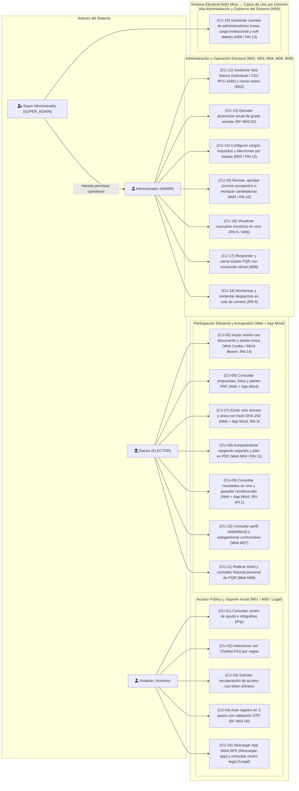
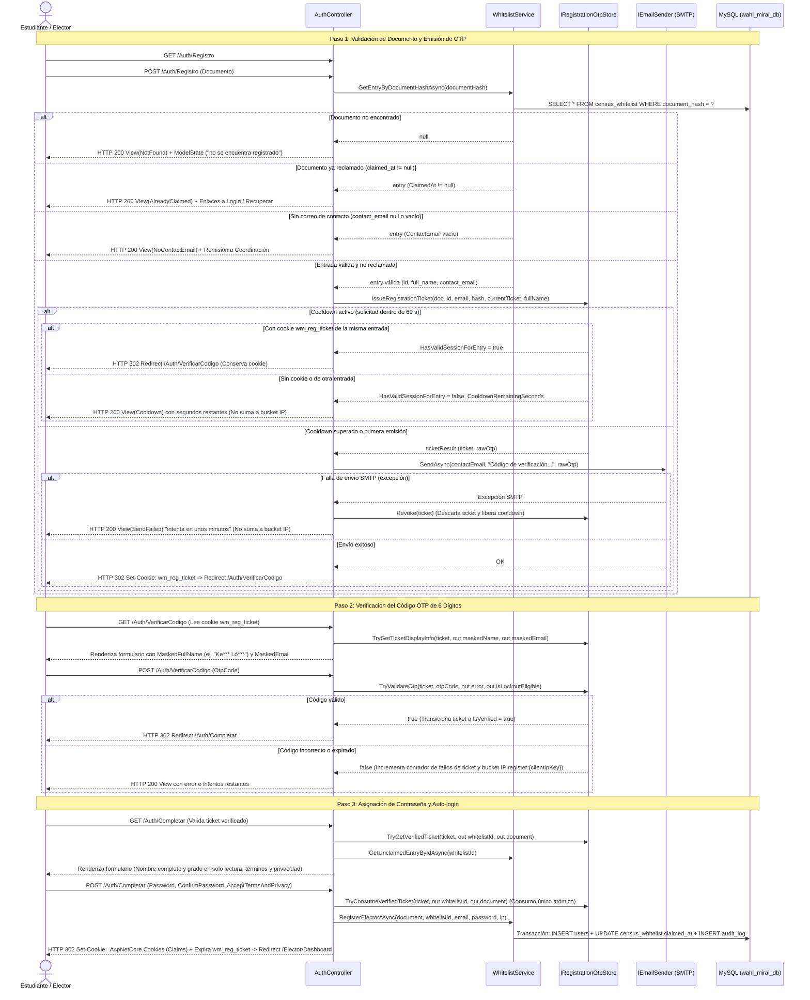
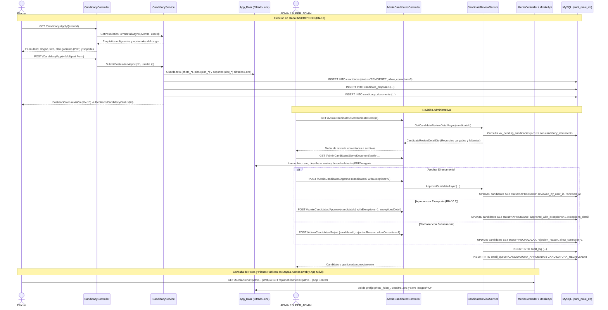
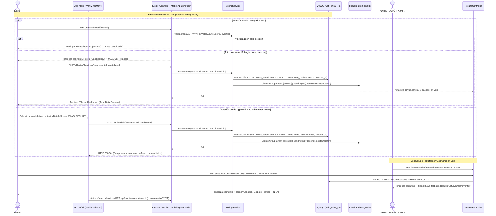

# Manual Técnico — Diagramas del Sistema Wahl Mirai
## Versión 3.2 (Sincronizada con Web, App Móvil Android y Despliegue Cloudflare Tunnel)

Este documento consolida y estandariza las **5 Figuras y el Diccionario de Datos** exigidos por la plantilla de especificación técnica institucional (Manual Técnico SIGA-UNI, Secciones 2 y 3), reflejando con exactitud la arquitectura real implementada en **ASP.NET Core 9.0 MVC**, C# 13, MySQL 8.0+ / MariaDB, Entity Framework Core 9, **Cloudflare Tunnel** y la **App Móvil Android (`WahlMirai.Movil`)**.

---

### Matriz de Correspondencia con el Manual Técnico de Referencia

| Figura / Sección | Exigencia del Manual (SIGA-UNI) | Estado Wahl Mirai | Archivo Independiente |
| :--- | :--- | :--- | :--- |
| **Figura 1** | **Arquitectura General y Despliegue** (Topología de red, túnel Cloudflare, Kestrel, almacenamiento, API móvil) | **Actualizado (Web + Móvil + Cloudflare)** | [figura_1_arquitectura_y_despliegue_v3_1.mmd](./figura_1_arquitectura_y_despliegue_v3_1.mmd) |
| **Figura 2** | **Diagrama de Casos de Uso por Rol** (4 Actores: Visitante, Elector, Administrador, Súper Admin) | **Actualizado (20 casos de uso Web/Móvil)** | [figura_2_casos_de_uso_por_rol_v3_1.mmd](./figura_2_casos_de_uso_por_rol_v3_1.mmd) |
| **Figura 3** | **Diagrama de Componentes y Dependencias** (Clientes Web/Android, Backend MVC + Mobile API + RAM, Persistencia) | **Actualizado (M01–M10 + Móvil)** | [figura_3_componentes_y_dependencias_v3_1.mmd](./figura_3_componentes_y_dependencias_v3_1.mmd) |
| **Figura 4** | **Diagramas de Secuencia de Procesos Clave** (Auto-registro OTP, Autopostulación/Medios, Votación Web/Móvil y Escrutinio) | **Actualizado (3 flujos sincronizados)** | [figura_4_1_secuencia_autoregistro_otp_v3_1.mmd](./figura_4_1_secuencia_autoregistro_otp_v3_1.mmd) [figura_4_2_secuencia_autopostulacion_v3_1.mmd](./figura_4_2_secuencia_autopostulacion_v3_1.mmd) [figura_4_3_secuencia_votacion_escrutinio_v3_1.mmd](./figura_4_3_secuencia_votacion_escrutinio_v3_1.mmd) |
| **Figura 5** | **Diagrama Entidad-Relación (DER)** (17 tablas físicas + 5 vistas SQL) | **Actualizado (`voting_events.description`)** | [figura_5_entidad_relacion_v3_1.mmd](./figura_5_entidad_relacion_v3_1.mmd) |
| **Sección 3.2** | **Diccionario de Datos Estructurado** (Tabla, Campo, Tipo, Longitud, Llave, Descripción) | **Completado (17 tablas + 5 vistas)** | [diccionario_de_datos_v3_1.md](./diccionario_de_datos_v3_1.md) |

---

## 1. Figura 1: Arquitectura General y Despliegue Físico (Sección 2.1 / 2.3)

La Figura 1 ilustra la topología de red y los nodos físicos/lógicos de infraestructura sobre los que opera el sistema:
1. **Nodos Cliente:** Navegadores web (escritorio y móvil) consumiendo Razor Views por HTTPS (`443`) y SignalR (`wss://`), junto con la **App Móvil Android (`WahlMirai.Movil`)** en Kotlin / Jetpack Compose consumiendo `/api/mobile/*` vía OkHttp + Retrofit con token `Bearer`.
2. **Capa Perimetral (Cloudflare Tunnel):** Túnel seguro publicado en `https://wahl-mirai.lat/` que gestiona la terminación TLS/HTTPS en el borde y enruta tráfico HTTP/HTTPS, WebSockets (`/hubs/resultsHub`) y API móvil hacia Kestrel local sin exponer puertos públicos directos.
3. **Servidor de Aplicaciones (.NET 9.0 Host / Kestrel):** Ejecuta `WahlMirai.Web` (puertos de desarrollo `5166` HTTP / `7062` HTTPS), incluyendo `StartupDiagnostics`, `DatabaseServerVersionResolver`, `ForwardedHeaders` opt-in (`X-Forwarded-For`, `X-Forwarded-Proto`), `MobileApiController`, almacenes singleton en RAM (`IActiveSessionStore`, `IRegistrationOtpStore`, `ILoginAttemptStore`, `IPasswordResetTokenStore`), `EmailQueueBackgroundService`, y almacenamiento cifrado `.enc` en `App_Data/candidacy-uploads/candidacies/` (servido por `/AdminCandidates/ServeDocument`, `/Media/Serve` y `/api/mobile/media`) más las llaves en `keys/`.
4. **Capa de Persistencia y Servicios Externos:** Servidor MySQL 8.0+ / MariaDB en el puerto `3306` (`wahl_mirai_db`: 17 tablas y 5 vistas) y servidor SMTP externo por STARTTLS (`587`).

```mermaid
flowchart TD
    subgraph ClientLayer ["Nodo Cliente / Dispositivos de Usuario"]
        DeskBrowser["Navegador Web Escritorio<br/>(Chrome, Firefox, Edge, Safari)"]
        MobileBrowser["Navegador Web Móvil<br/>(Chrome Android, Safari iOS)"]
        AndroidApp["App Móvil Android (WahlMirai.Movil)<br/>Kotlin / Jetpack Compose + Retrofit/OkHttp<br/>Bearer Token + Auto-escrutinio"]
    end

    subgraph EdgeLayer ["Capa Perimetral / Túnel Seguro (Producción)"]
        CloudflareTunnel["Cloudflare Tunnel (https://wahl-mirai.lat/)<br/>Terminación TLS/HTTPS en Borde (Puerto 443 TCP)<br/>• Enrutamiento hacia Kestrel local<br/>• Soporte WebSockets (/hubs/resultsHub)<br/>• API REST Móvil (/api/mobile/*)"]
    end

    subgraph AppServerNode ["Nodo Servidor de Aplicaciones (.NET 9.0 Host / Kestrel)"]
        subgraph AppRuntime ["Runtime ASP.NET Core 9.0 (Kestrel — Dev: 5166 HTTP / 7062 HTTPS)"]
            AppEngine["WahlMirai.Web Engine (C# 13 / .NET 9.0 MVC)<br/>• StartupDiagnostics & DatabaseServerVersionResolver<br/>• ForwardedHeaders (opt-in X-Forwarded-For/Proto)<br/>• RateLimiting (AuthLogin, AuthRegister, AuthRecovery)<br/>• CookieAuthenticationEvents.OnValidatePrincipal"]
            MobileApi["MobileApiController (/api/mobile/*)<br/>Login, Logout, Profile, Events, Vote y Media<br/>Tokens Bearer cifrados con IDataProtectionProvider"]
            SignalREndpoint["Endpoint SignalR Hub<br/>(/hubs/resultsHub)<br/>Transmisión en vivo de escrutinio"]
            BackgroundWorker["Worker Asíncrono en Segundo Plano<br/>(EmailQueueBackgroundService : IHostedService)<br/>Despacho controlado 1-60 correos/min (RN-9)"]
        end

        subgraph RAMState ["Almacenes de Estado Volátil en Memoria RAM (Singleton)"]
            ActiveSessionStore["IActiveSessionStore<br/>Control de Sesión Única Activa (RN-14)<br/>ConcurrentDictionary&lt;uint, SessionEntry&gt;"]
            OtpStore["IRegistrationOtpStore<br/>Tickets SHA-256 + OTP 6 dígitos (TTL 15 min)<br/>Límite 5 intentos + Cooldown 60 s (RF-M01-00)"]
            LockoutStore["ILoginAttemptStore<br/>Protección Brute-Force (RN-15)<br/>Buckets IP por ClientIpKey"]
            ResetTokenStore["IPasswordResetTokenStore / IPendingPasswordStore<br/>Tokens efímeros de recuperación y contraseñas temporales"]
        end

        subgraph ProtectedStorage ["Sistema de Archivos Local Protegido (Fuera de wwwroot)"]
            EncryptedDocs["App_Data/candidacy-uploads/candidacies/<br/>Archivos Cifrados *.enc (Fotos, Planes, Soportes)<br/>Descifrado vía /AdminCandidates/ServeDocument,<br/>/Media/Serve (Web) y /api/mobile/media (Móvil)"]
            DataProtectionKeys["keys/<br/>Repositorio de Llaves Criptográficas XML<br/>(AES-256 Data Protection para docs y tokens móviles)"]
        end
    end

    subgraph DatabaseNode ["Nodo de Base de Datos Relacional (MySQL / MariaDB)"]
        MySQLInstance["Servidor MySQL 8.0+ / MariaDB (Puerto 3306 TCP)<br/>Base de Datos: wahl_mirai_db<br/>• 17 Tablas Físicas Normalizadas (InnoDB / utf8mb4)<br/>• 5 Vistas SQL Optimizadas (Keyless EF Core)"]
    end

    subgraph ExternalRelay ["Servicios Externos de Red"]
        SMTPServer["Servidor SMTP Institucional / Relay Externo<br/>Puertos 587 (STARTTLS) / 465 (TLS/SSL)<br/>Despacho transaccional de correos"]
    end

    DeskBrowser -->|"HTTPS / TLS 1.3 (Puerto 443 TCP)"| CloudflareTunnel
    DeskBrowser -.->|"WSS / WebSockets (Puerto 443 TCP)"| CloudflareTunnel
    MobileBrowser -->|"HTTPS / TLS 1.3 (Puerto 443 TCP)"| CloudflareTunnel
    MobileBrowser -.->|"WSS / WebSockets (Puerto 443 TCP)"| CloudflareTunnel
    AndroidApp -->|"HTTPS + Bearer Token (/api/mobile/*)"| CloudflareTunnel

    CloudflareTunnel -->|"HTTP / HTTPS Loopback hacia Kestrel"| AppEngine
    CloudflareTunnel -->|"API REST Móvil (/api/mobile/*)"| MobileApi
    CloudflareTunnel -.->|"Upgrade: websocket (/hubs/resultsHub)"| SignalREndpoint

    AppEngine <-->|"In-Memory (DI / Singleton)"| RAMState
    MobileApi <-->|"Validación Sesión Única y Lockout"| RAMState
    AppEngine <-->|"Lectura / Escritura Cifrada (File I/O)"| ProtectedStorage
    MobileApi <-->|"Descifrado /api/mobile/media y Tokens"| ProtectedStorage
    AppEngine -.->|"Disparo de Evento de Escrutinio"| SignalREndpoint
    MobileApi -.->|"Disparo de Evento de Escrutinio"| SignalREndpoint
    BackgroundWorker <-->|"Consulta de Secretos / Tokens en RAM"| RAMState

    AppEngine -->|"TCP / IP (Puerto 3306)<br/>Pomelo EF Core 9"| MySQLInstance
    MobileApi -->|"TCP / IP (Puerto 3306)<br/>Pomelo EF Core 9"| MySQLInstance
    BackgroundWorker -->|"TCP / IP (Puerto 3306)<br/>vw_pending_email_queue y UPDATE status"| MySQLInstance

    AppEngine -->|"SMTP / STARTTLS (Puerto 587 TCP)<br/>Despacho Síncrono OTP"| SMTPServer
    BackgroundWorker -->|"SMTP / STARTTLS (Puerto 587 TCP)<br/>Despacho Asíncrono MailKitEmailSender"| SMTPServer
```

---

## 2. Figura 2: Diagrama de Casos de Uso por Rol (Sección 2.3)

La Figura 2 modela los 4 actores del sistema y los 20 casos de uso actuales entre la plataforma web y la app móvil:
1. **Visitante / Usuario Anónimo:** Consulta centro de ayuda (`/Pqr`), interactúa con el Chatbot FAQ por reglas, solicita recuperación de acceso con token efímero, ejecuta auto-registro en 3 pasos con OTP (RF-M01-00), descarga el APK móvil (`/descargar-app`) y consulta el centro legal (`/Legal`).
2. **Elector (`ELECTOR`):** Inicia sesión validando sesión única (Web Cookie o Móvil Bearer, RN-14), consulta propuestas, fotos y planes PDF (Web y Móvil), emite voto secreto y único (RN-3), se autopostula en la web (M04), consulta resultados en vivo y ganador condicionado (Web y Móvil, RN-4/4.1), consulta/autogestiona perfil (M07) y radica PQR (M08).
3. **Administrador (`ADMIN`):** Administra lista blanca y censo activo (M02), ejecuta promoción anual de grado (RF-M02-02), configura cargos, requisitos y elecciones por etapas (M03), revisa y aprueba/rechaza candidaturas (M04), consulta escrutinio irrestricto en vivo (RN-5), responde PQR (M08) y supervisa cola de correos (RN-9).
4. **Súper Administrador (`SUPER_ADMIN`):** Hereda todas las facultades de `ADMIN` y gestiona exclusivamente cuentas administrativas con cargo institucional asignable y baja lógica sin auto-eliminación (M09 / RN-13).

---

## 3. Figura 3: Diagrama de Componentes y Dependencias (Sección 2.3)

La Figura 3 estructura los componentes de software en tres bloques jerárquicos:
1. **Capa Cliente / Presentación:**
   * **Cliente Web:** Layouts por contexto (`_Layout`, `_ElectorLayout`, `_AdminLayout`), Tailwind CSS v4, motor i18n (`locale-core.js` + diccionarios en 6 idiomas), `theme.js`, `ayuda-chatbot.js`, cliente SignalR (`/hubs/resultsHub`) y scripts AJAX (`pqr-manage.js`, `auth-completar.js`).
   * **App Móvil Android (`WahlMirai.Movil`):** Pantallas Jetpack Compose con mosaico electoral (`VotingPatternBackground`), `FLAG_SECURE` global, `VotingDataStore`, `ApiClient` (Retrofit/OkHttp con interceptor `Bearer`), `SessionManager`, `CandidateAvatar` y `PdfHelper` (`PdfRenderer`).
2. **Capa de Back-end (ASP.NET Core 9.0):**
   * **Pipeline y Seguridad:** `StartupDiagnostics`, `ForwardedHeaders` opt-in, `RateLimiting` (`ClientIpKey`), `CookieAuthenticationEvents.OnValidatePrincipal` (Web), validación de token `Bearer` cifrado con `IDataProtectionProvider` (Móvil) y almacenes volátiles en RAM (`IActiveSessionStore`, `ILoginAttemptStore`, `IRegistrationOtpStore`, `IPasswordResetTokenStore`).
   * **Módulos de Dominio (Controladores + Servicios):** M01 a M09, más M10 (`MobileApiController`, `HomeController` con `/descargar-app`, `LegalController` y `ErrorController`), `MediaController` (`/Media/Serve`) y el worker `EmailQueueBackgroundService`.
   * **Servicios Transversales:** `AuditService`, `DocumentEncryptionService` y `MailKitEmailSender`.
3. **Capa de Persistencia y Datos:** Contexto `WahlMiraiDbContext` (`DatabaseServerVersionResolver` + `SplitQuery`, EF Core 9 con Pomelo MySQL Provider) conectado a `wahl_mirai_db` (17 tablas físicas y 5 vistas keyless).

```mermaid
flowchart TD
    subgraph ClientPresentationLayer ["Capa de Presentación / Clientes (Web + App Móvil Android)"]
        subgraph WebPresentation ["Cliente Web (Navegador + Razor Engine + Tailwind CSS v4)"]
            LayoutsView["Layouts de Navegación por Contexto<br/>(_Layout, _ElectorLayout, _AdminLayout)"]
            I18nEngine["Motor i18n Cliente<br/>(locale-core.js + locale.&lt;lang&gt;.js en 6 idiomas)"]
            ThemeManager["Gestor de Tema<br/>(theme.js - Dark/Light con localStorage)"]
            ChatbotEngine["Motor Chatbot FAQ<br/>(ayuda-chatbot.js - Reglas sin IA + Lightbox)"]
            SignalRClient["Cliente SignalR<br/>(/hubs/resultsHub - ReceiveResultsUpdate)"]
            AjaxModules["Scripts AJAX Reactivos<br/>(pqr-manage.js, auth-completar.js)"]
        end

        subgraph MobileClient ["App Móvil Android (WahlMirai.Movil — Kotlin / Jetpack Compose)"]
            MobileUI["Pantallas Compose + Mosaico Electoral<br/>(Login, Votaciones, Detalle/Ganador, Plan PDF, Perfil)<br/>FLAG_SECURE Global + VotingDataStore"]
            MobileNetwork["ApiClient (Retrofit / OkHttp) + SessionManager<br/>Header Authorization: Bearer + Manejo 401<br/>CandidateAvatar & PdfHelper (PdfRenderer)"]
        end
    end

    subgraph BackendAppLayer ["Capa de Back-end (ASP.NET Core 9.0 Host — StartupDiagnostics)"]

        subgraph SecurityPipeline ["Pipeline de Solicitudes y Seguridad Transversal"]
            ForwardedHdrs["ForwardedHeaders Middleware (opt-in)<br/>(Procesamiento de X-Forwarded-For y Proto)"]
            RateLimiter["Motor RateLimiting<br/>(AuthLogin, AuthRegister, AuthRecovery con ClientIpKey)"]
            CookieAuth["Autenticación Web (Cookies + Claims)<br/>CookieAuthenticationEvents.OnValidatePrincipal (RN-14)"]
            BearerAuth["Autenticación API Móvil (Bearer Token)<br/>IDataProtectionProvider + ValidateSessionStamp (RN-14)"]

            subgraph RAMStores ["Almacenes en Memoria RAM (Singleton / ConcurrentDictionary / IMemoryCache)"]
                ActiveSessionStore["IActiveSessionStore (Sesión Única Activa)"]
                LoginAttemptStore["ILoginAttemptStore (Control Lockout por IP)"]
                RegOtpStore["IRegistrationOtpStore (OTP + Tickets SHA-256)"]
                ResetTokenStore["IPasswordResetTokenStore / IPendingPasswordStore"]
            end
        end

        subgraph DomainModules ["Módulos de Dominio (Controladores MVC, API Móvil y Servicios)"]
            M01["M01: Autenticación, Registro y Recuperación<br/>[AuthController, RecuperacionAccesoController]<br/>(AuthService, CredentialService)"]
            M02["M02: Censo Electoral y Lista Blanca<br/>[AdminCensusController]<br/>(CensusService, WhitelistService, PromotionService)"]
            M03["M03: Eventos Electorales y Cargos<br/>[AdminEventsController]<br/>(EventService)"]
            M04["M04: Autopostulación, Revisión y Medios<br/>[CandidacyController, AdminCandidatesController, MediaController]<br/>(CandidacyService, CandidateReviewService)"]
            M05["M05: Votación y Control de Voto Único<br/>[ElectorController]<br/>(VotingService)"]
            M06["M06: Escrutinio y Resultados en Vivo<br/>[ResultsController, ResultsHub (SignalR)]"]
            M07["M07: Perfil de Usuario y Autogestión<br/>[ProfileController]<br/>(ProfileService)"]
            M08["M08: Ayuda, Chatbot FAQ y Gestión PQR<br/>[PqrController]<br/>(PqrService)"]
            M09["M09: Cuentas Administrativas<br/>[AdminAccountsController]<br/>(AdminAccountService)"]
            M10["M10: API REST Móvil y Descarga APK<br/>[MobileApiController (/api/mobile/*), HomeController (/descargar-app),<br/>LegalController, ErrorController]"]
            WorkerEmail["Worker Asíncrono en Segundo Plano<br/>[EmailQueueBackgroundService (IHostedService)]"]
        end

        subgraph CrossCuttingServices ["Servicios Transversales Internos"]
            AuditService["AuditService<br/>(Trazabilidad forense en tabla audit_log)"]
            CryptoService["DocumentEncryptionService<br/>(Cifrado AES-256 ASP.NET Data Protection para .enc)"]
            EmailSender["MailKitEmailSender (IEmailSender)<br/>(Despacho síncrono/asíncrono SMTP/STARTTLS)"]
        end
    end

    subgraph DataPersistenceLayer ["Capa de Datos y Persistencia (MySQL / MariaDB)"]
        DbContext["WahlMiraiDbContext<br/>(Entity Framework Core 9.0 + Pomelo MySQL Provider)<br/>DatabaseServerVersionResolver + SplitQuery"]

        subgraph MySQLSchema ["wahl_mirai_db (Esquema Relacional)"]
            PhysicalTables["17 Tablas Físicas Normalizadas<br/>(users, roles, grades, academic_years, census_whitelist,<br/>voting_events, election_positions, position_requirements,<br/>event_grades, candidates, candidate_proposals, candidacy_documents,<br/>votes, event_participations, audit_log, pqr_tickets, email_queue)"]
            SqlViews["5 Vistas MySQL Mapeadas Keyless<br/>(vw_vote_counts, vw_active_census, vw_pending_whitelist,<br/>vw_pending_email_queue, vw_pending_candidacies)"]
        end
    end

    WebPresentation -->|"Peticiones HTTP/HTTPS & AJAX"| ForwardedHdrs
    MobileUI --> MobileNetwork
    MobileNetwork -->|"HTTPS + Bearer (/api/mobile/*)"| ForwardedHdrs
    ForwardedHdrs --> RateLimiter
    RateLimiter --> CookieAuth
    RateLimiter --> BearerAuth
    CookieAuth --> DomainModules
    BearerAuth --> M10
    CookieAuth <-->|"Validación de SessionStamp en RAM"| ActiveSessionStore
    BearerAuth <-->|"Validación de SessionStamp en RAM"| ActiveSessionStore

    DomainModules <-->|"Control de Intentos y Lockout"| LoginAttemptStore
    M01 <-->|"Gestión OTP y Tickets"| RegOtpStore
    M01 <-->|"Tokens y Passwords Efímeros"| ResetTokenStore
    M01 <-->|"Registro / Revocación Sesión"| ActiveSessionStore
    M02 <-->|"Revocación Inmediata de Sesión (RN-14)"| ActiveSessionStore
    M07 <-->|"Revocación Inmediata de Sesión (RN-14)"| ActiveSessionStore
    M09 <-->|"Revocación Inmediata de Sesión (RN-14)"| ActiveSessionStore
    M10 <-->|"Registro / Revocación Sesión Móvil (RN-14)"| ActiveSessionStore

    M01 --> AuditService
    M02 --> AuditService
    M03 --> AuditService
    M04 --> AuditService
    M05 --> AuditService
    M06 --> AuditService
    M07 --> AuditService
    M09 --> AuditService
    M10 --> AuditService

    M02 --> CryptoService
    M04 --> CryptoService
    M07 --> CryptoService
    M10 --> CryptoService

    M01 --> EmailSender
    M02 --> EmailSender
    WorkerEmail --> EmailSender

    SignalRClient <-->|"WebSockets (WSS)"| M06
    M05 -.->|"Notificación de nuevo voto"| M06
    M10 -.->|"CastVoteAsync -> ReceiveResultsUpdate"| M06

    DomainModules --> DbContext
    WorkerEmail --> DbContext
    AuditService --> DbContext

    DbContext --> PhysicalTables
    DbContext --> SqlViews
```

---

## 4. Figura 4: Diagramas de Secuencia de Procesos Clave (Sección 2.3)

### 4.1 Secuencia de Auto-registro con OTP en 3 Pasos (RF-M01-00)

### 4.2 Secuencia de Autopostulación, Revisión y Entrega Segura de Medios (RF-M04-01, RF-M04-02)

### 4.3 Secuencia de Votación y Escrutinio en Tiempo Real (RF-M05-00, RF-M06-00)

---

## 5. Figura 5: Diagrama Entidad-Relación (DER) (Sección 3.1)

El modelo de datos relacional opera sobre el esquema `wahl_mirai_db`, normalizado en 17 tablas físicas bajo motor `InnoDB` y 5 vistas SQL optimizadas:

```mermaid
erDiagram
    roles ||--o{ users : "asigna_rol"
    grades ||--o{ users : "pertenece_a_grado"
    grades ||--o{ census_whitelist : "pertenece_a_grado"
    users ||--o{ census_whitelist : "carga_lista_blanca"
    users |o--o| census_whitelist : "reclama_registro"
    grades ||--o{ event_grades : "habilitado_en"
    election_positions ||--o{ position_requirements : "define_requisitos"
    election_positions ||--o{ voting_events : "clasifica_cargo"
    voting_events ||--o{ event_grades : "clasifica_grados"
    users ||--o{ email_queue : "receptores_cola"
    users ||--o{ voting_events : "creado_por"
    voting_events ||--o{ candidates : "recibe_postulaciones"
    users |o--o{ candidates : "se_autopostula"
    users ||--o{ candidates : "revisa_candidatura"
    candidates ||--o{ candidate_proposals : "posee_propuestas"
    candidates ||--o{ candidacy_documents : "adjunta_soportes"
    position_requirements ||--o{ candidacy_documents : "exige_soporte"
    voting_events ||--o{ votes : "recibe_votos"
    candidates ||--o{ votes : "acumula_votos"
    users ||--o{ event_participations : "registra_participacion"
    voting_events ||--o{ event_participations : "rastrea_emision"
    users ||--o{ audit_log : "ejecuta_accion"
    users ||--o{ pqr_tickets : "crea_ticket"
    users |o--o{ pqr_tickets : "resuelve_ticket"

    roles {
        TINYINT id PK
        VARCHAR_30 name "UK - ELECTOR, ADMIN, SUPER_ADMIN"
        VARCHAR_100 description
    }

    academic_years {
        SMALLINT id PK
        SMALLINT year "UK"
        TINYINT_1 is_current
        DATETIME promotion_executed_at
        DATETIME created_at
    }

    grades {
        TINYINT id PK
        VARCHAR_10 name "UK"
        TINYINT sequence_order "UK"
        TINYINT_1 is_last_grade
    }

    census_whitelist {
        INT id PK
        CHAR_64 document_hash "UK"
        VARCHAR_500 encrypted_document
        VARCHAR_150 full_name
        VARCHAR_150 contact_email "Nullable"
        TINYINT grade_id FK
        TINYINT_1 excluir_de_promocion
        DATETIME claimed_at "NULL = no reclamado"
        INT claimed_by_user_id FK "Nullable"
        INT uploaded_by_user_id FK
        DATETIME created_at
    }

    users {
        INT id PK
        TINYINT role_id FK
        TINYINT grade_id FK "NULL para cuentas administrativas"
        CHAR_64 document_hash "UK"
        VARCHAR_500 encrypted_document
        VARCHAR_150 full_name
        VARCHAR_150 contact_email
        VARCHAR_255 password_hash
        VARCHAR_100 position_title "Solo ADMIN/SUPER_ADMIN"
        TINYINT_1 excluir_de_promocion
        ENUM status "ACTIVO, INACTIVO, ELIMINADO, EGRESADO"
        DATETIME deleted_at
        DATETIME registered_at
        DATETIME updated_at
    }

    email_queue {
        BIGINT id PK
        INT user_id FK
        ENUM email_type "RECUPERACION_ACCESO, REASIGNACION_ADMIN, CAMBIO_PERFIL, RESPUESTA_PQR, CANDIDATURA_APROBADA, CANDIDATURA_RECHAZADA"
        ENUM status "PENDIENTE, ENVIADO, FALLIDO"
        TINYINT attempts
        TEXT error_message
        DATETIME created_at
        DATETIME sent_at
    }

    election_positions {
        INT id PK
        VARCHAR_100 name "UK - Personero, Contralor, etc."
        TEXT description
        ENUM status "ACTIVO, INACTIVO"
        DATETIME created_at
    }

    position_requirements {
        INT id PK
        INT position_id FK
        VARCHAR_255 description
        TINYINT_1 is_mandatory
        TINYINT display_order
    }

    voting_events {
        INT id PK
        INT created_by_user_id FK
        INT position_id FK
        VARCHAR_200 title
        TEXT description "Nullable"
        ENUM election_type "PERSONAS, TEMAS"
        DATE registration_start_date
        TIME registration_start_time
        DATE registration_end_date
        TIME registration_end_time
        DATE proposals_start_date
        TIME proposals_start_time
        DATE proposals_end_date
        TIME proposals_end_time
        DATE voting_start_date
        TIME voting_start_time
        DATE voting_end_date
        TIME voting_end_time
        ENUM status "PROGRAMADA, INSCRIPCION, PROPUESTAS, ACTIVA, FINALIZADA, ELIMINADO"
        DATETIME deleted_at
        DATETIME created_at
        DATETIME updated_at
    }

    event_grades {
        INT id PK
        INT voting_event_id FK
        TINYINT grade_id FK
    }

    candidates {
        INT id PK
        INT voting_event_id FK
        INT user_id FK "Nullable si es voto en blanco"
        VARCHAR_150 name
        TEXT slogan
        VARCHAR_500 photo_url
        VARCHAR_500 government_plan_url
        TINYINT_1 is_blank_vote
        ENUM status "PENDIENTE, APROBADO, RECHAZADO, RETIRADO"
        TINYINT_1 approved_with_exceptions
        TEXT exceptions_detail
        TEXT rejection_reason
        TINYINT_1 allow_correction
        INT reviewed_by_user_id FK "Nullable"
        DATETIME reviewed_at
        DATETIME enrolled_at
    }

    candidate_proposals {
        INT id PK
        INT candidate_id FK
        TEXT content
        TINYINT display_order
    }

    candidacy_documents {
        INT id PK
        INT candidate_id FK
        INT requirement_id FK
        VARCHAR_500 file_url
        DATETIME uploaded_at
    }

    votes {
        BIGINT id PK
        INT voting_event_id FK
        INT candidate_id FK
        VARCHAR_64 vote_hash "UK - SHA-256 criptografico"
        DATETIME voted_at
    }

    event_participations {
        INT id PK
        INT user_id FK
        INT voting_event_id FK
        DATETIME participated_at
    }

    audit_log {
        BIGINT id PK
        INT user_id FK "Nullable si fue el sistema"
        VARCHAR_100 action
        VARCHAR_200 target_entity
        INT target_id
        VARCHAR_100 field_name
        TEXT old_value
        TEXT new_value
        TEXT details
        VARCHAR_45 ip_address
        DATETIME occurred_at
    }

    pqr_tickets {
        BIGINT id PK
        INT user_id FK
        VARCHAR_200 subject
        TEXT message
        ENUM status "ABIERTO, RESUELTO"
        TEXT admin_response
        INT responded_by_user_id FK "Nullable"
        DATETIME responded_at
        DATETIME created_at
        DATETIME updated_at
    }
```

---

## 6. Sección 3.2: Diccionario de Datos

La especificación exhaustiva de cada tabla, campo, tipo, longitud, llaves y descripciones se encuentra documentada en el archivo técnico complementario:
* 👉 **[Diccionario de Datos Completo (17 Tablas Físicas + 5 Vistas SQL)](./diccionario_de_datos_v3_1.md)**

A continuación se presenta un resumen de las entidades principales:
* **Entidades de Seguridad y Censo:** `roles`, `academic_years`, `grades`, `census_whitelist`, `users`, `audit_log`, `email_queue`.
* **Entidades Electorales y Candidaturas:** `election_positions`, `position_requirements`, `voting_events`, `event_grades`, `candidates`, `candidate_proposals`, `candidacy_documents`.
* **Entidades de Sufragio y Participación:** `votes` (urna anónima inmutable sin `user_id`, RN-3), `event_participations` (padrón anti-duplicado).
* **Entidades de Soporte y Atención:** `pqr_tickets`.
* **Vistas SQL Mapeadas Keyless:** `vw_vote_counts`, `vw_active_census`, `vw_pending_whitelist`, `vw_pending_email_queue`, `vw_pending_candidacies`.
